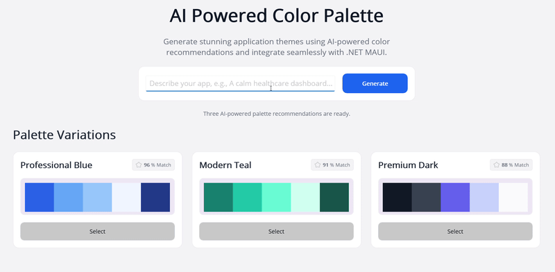

# AI-Powered Color Palette Generation in .NET MAUI ColorPicker

This sample demonstrates AI-powered color palette generation with the Syncfusion® .NET MAUI ColorPicker. The application integrates Azure OpenAI to analyze a free-text description of an app or product and generate three distinct, ready-to-use color palettes that are displayed in the Syncfusion® .NET MAUI ColorPicker.

## Overview

Choosing a color theme that suits an application's purpose and mood can be time-consuming. This sample uses Azure OpenAI to interpret a natural language description and transform it into curated color palettes.

The AI-powered palette generation engine analyzes:

- App or product description
- Industry and purpose
- Mood and style keywords
- Color harmony
- Visual accessibility
- Relevance of each palette to the prompt

Based on the AI response, three palette recommendations are created, each containing:

- Theme name
- Match percentage
- Five hex colors
- Rationale

For example, if the user enters:

```text
A calm healthcare dashboard
```

The AI generates three palette variations, such as:

- Palette 1 - highest match, five harmonious colors
- Palette 2 - alternative color combination
- Palette 3 - alternative color combination

The palettes are sorted from the highest to the lowest match percentage and displayed directly in the Syncfusion® .NET MAUI ColorPicker, allowing users to preview, review, and pick any color from the generated palettes.

## Key Features

- Syncfusion® .NET MAUI ColorPicker integration
- Azure OpenAI-powered color palette generation
- Three palette recommendations for every prompt
- Theme name and match percentage for each palette
- Inline ColorPicker in `Palette` mode with five colors per palette
- Natural language style description input
- Busy indicator and status message during generation
- Built-in default and fallback palettes when the AI response is unavailable or invalid
- MVVM-based architecture
- Cross-platform .NET MAUI application

## Sample

```xaml
<inputs:SfColorPicker
    x:Name="FirstColorPicker"
    ColorMode="Palette"
    IsInline="True"
    IsOpen="True"
    PaletteColumnCount="5"
    PaletteRowCount="1"
    PaletteCellSize="80"
    ShowRecentColors="False"
    IsActionButtonsVisible="False"
    IsColorModeSwitcherVisible="False" />
```

### Azure OpenAI Palette Generation

```csharp
var prompt =
    "You are a professional UI/UX color designer and naming expert.\n\n" +
    "Analyze the following product or app description:\n\n" +
    $"\"{styleDescription}\"\n\n" +
    "Return ONLY valid JSON as an array of exactly three palette recommendations.\n" +
    "Each recommendation must include: themeName, matchPercentage, colors (five hex values), and rationale.\n\n" +
    "Guidelines:\n" +
    "- Generate three distinct recommendations with unique names and color combinations.\n" +
    "- Match percentages should be believable, sorted highest to lowest.\n" +
    "- Colors must be visually accessible and relevant to the prompt.\n" +
    "- Return only JSON without markdown or commentary.";

var response = await aiService.GetResultsFromAI(prompt);
```

### Applying the Palette to the ColorPicker

```csharp
var paletteColors = new ObservableCollection<Color>();

foreach (var color in colors.Take(5))
{
    if (Color.TryParse(color, out var parsedColor))
    {
        paletteColors.Add(parsedColor);
    }
}

picker.PaletteColors = paletteColors;

if (paletteColors.Count > 0)
{
    picker.SelectedColor = paletteColors[0];
}
```

## How It Works

1. The user enters a description of the app or desired style, such as *A calm healthcare dashboard*.
2. The user clicks **Generate**.
3. The application sends the description to Azure OpenAI.
4. Azure OpenAI returns a JSON array of three palette recommendations.
5. The response is parsed and validated. If the response is empty or invalid, fallback palettes are used.
6. Each palette is bound to its own Syncfusion® .NET MAUI ColorPicker as `PaletteColors`.
7. The first color of each palette is selected by default.
8. The user can pick any color from the generated palettes.

## Output



## Project Structure

| File | Description |
|------|-------------|
| `MainPage.xaml` / `MainPage.xaml.cs` | UI with the prompt input, Generate button, and three ColorPicker palettes |
| `ViewModel/MainViewModel.cs` | Holds the prompt, busy state, status text, and the three palettes |
| `Services/SmartColorPaletteService.cs` | Builds the AI prompt, parses the response, and provides fallback palettes |
| `Services/AzureBaseService.cs` | Azure OpenAI connection, credential validation, and chat requests |
| `Models/ColorPaletteResponse.cs` | Palette model returned by the AI service |
| `Models/SmartColorPalette.cs` | Bindable palette model used by the UI |
| `MauiProgram.cs` | Service, view model, and Syncfusion® registration |

## Prerequisites

Before running the sample, ensure that you have:

- Visual Studio 2022 (latest update) or later with the .NET MAUI workload installed
- .NET 10 SDK
- Azure OpenAI resource and deployment
- Syncfusion® .NET MAUI Inputs package (includes the ColorPicker)
- Valid Syncfusion® license key

For .NET MAUI requirements, refer to: https://help.syncfusion.com/maui/system-requirements

## Azure OpenAI Configuration

Set your Azure OpenAI values in `SmartColorPaletteGenerator/Services/AzureBaseService.cs` before running the application:

```csharp
protected static readonly string Endpoint = "AZURE_OPENAI_ENDPOINT";
protected static readonly string DeploymentName = "AZURE_OPENAI_DEPLOYMENT";
protected static readonly string ApiKey = "AZURE_OPENAI_KEY";
```

The application validates the Azure OpenAI credentials during startup. If the credentials are invalid, a message is written to the debug output.

> **Note:** Do not commit real API keys to source control.

## Troubleshooting

### Invalid API Key or Endpoint

If the application cannot connect to Azure OpenAI:

- Verify the Endpoint URL.
- Verify the API Key.
- Confirm the Deployment Name exists.
- Ensure the deployment supports chat completion requests.

### Palette Generation Failed

If the default or fallback palettes are shown instead of AI-generated palettes:

- Verify Azure OpenAI connectivity.
- Check deployment availability.
- Review the debug output for the raw AI response.
- Confirm the response is a JSON array containing `themeName`, `matchPercentage`, `colors`, and `rationale`.

### ColorPicker Not Updating

If the ColorPicker does not show the generated colors:

- Ensure `PaletteColors` is assigned an `ObservableCollection<Color>`.
- Verify that the generated values are valid hex colors.
- Confirm `ColorMode` is set to `Palette`.

### Path Too Long Exception

If you encounter a **"Path Too Long"** exception while building the project:

1. Close Visual Studio.
2. Rename the repository folder to a shorter name.
3. Delete the `bin`, `obj`, and `.vs` folders.
4. Rebuild the project.

## License

Syncfusion has no liability for any damage or consequence that may arise from using or viewing the samples. The samples are for demonstrative purposes. If you choose to use or access the samples, you agree to not hold Syncfusion liable, in any form, for any damage related to use, for accessing, or viewing the samples.

By accessing, viewing, or using the samples, you acknowledge and agree that Syncfusion's samples will not allow you to seek injunctive relief in any form for any claim related to the sample.

If you do not agree to this, do not view, access, utilize, or otherwise interact with Syncfusion's samples.
