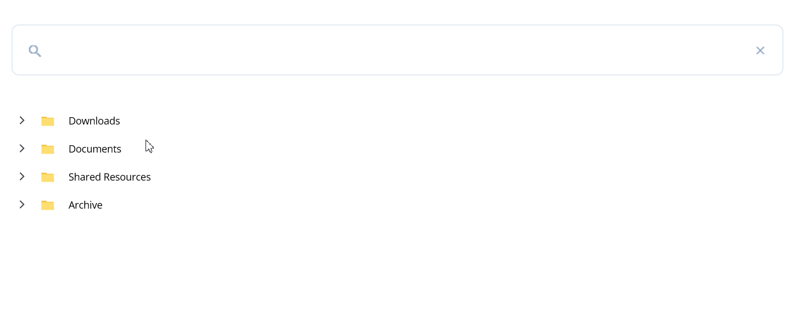

# AI-Powered File Search in .NET MAUI TreeView

This sample demonstrates AI-powered semantic file search with the Syncfusion .NET MAUI TreeView. It uses Azure OpenAI to understand natural-language queries, find relevant files from their metadata, and highlight the matching results in a hierarchical file view.

## Overview

Searching a large collection of files by name alone can make relevant information difficult to find. This sample evaluates a query against file names, folder paths, keywords, file types, and created or modified dates to identify and rank relevant files.

The results are displayed in the Syncfusion .NET MAUI TreeView. Matching files are highlighted, and a result count helps users see how many files matched their search.

If Azure OpenAI is not configured, the app shows a "Configuration Required" alert at startup so the cause is obvious.

## Key Features

   - Syncfusion .NET MAUI TreeView integration
   - Azure OpenAI-powered semantic search
   - Natural-language file queries
   - Search across file and folder metadata
   - Ranked file results with matching paths highlighted
   - Hierarchical file and folder display
   - Search result count and clear-search action
   - Debounced search with a request-version guard
   - Cross-platform .NET MAUI application

## Sample

```xaml
<core:SfTextInputLayout ContainerType="Outlined">
    <Entry x:Name="searchEntry"
           Placeholder="Search files..." />
</core:SfTextInputLayout>

<treeview:SfTreeView ItemsSource="{Binding SalesFileNodes}"
                     ChildPropertyName="SubFiles"
                     ItemTemplateContextType="Node"
                     AutoExpandMode="None"
                     ExpandActionTarget="Expander" />
```

The TreeView binds to `SalesFileViewModel.SalesFileNodes` (full tree) and is swapped to `FilteredSalesFileNodes` while a search is active.

## Output



## Requirements to run the demo

To run the demo, refer to https://help.syncfusion.com/maui/system-requirements

## Prerequisites

Before running the sample, ensure that you have:

- Visual Studio with .NET MAUI workload installed
- .NET 10 SDK or later
- Azure OpenAI resource and chat deployment
- Valid Syncfusion license key (community licence is acceptable for evaluation)

### Azure OpenAI credentials

Set the following environment variables before launching the app:

| Variable | Description |
|----------|-------------|
| `AZURE_OPENAI_ENDPOINT` | Your Azure OpenAI endpoint, e.g. `https://your-resource.openai.azure.com/` |
| `AZURE_OPENAI_DEPLOYMENT_NAME` | Name of the chat deployment |
| `AZURE_OPENAI_API_KEY` | API key for the Azure OpenAI resource |

You can set them in your IDE launch profile, in your shell, or in the project's debug properties. The app reads the variables at startup and surfaces a "Configuration Required" alert if any value is missing or the endpoint is malformed.

### Syncfusion license key

Set the `SYNCFUSION_LICENSE_KEY` environment variable to your license key before launching the app. Without a valid license, Syncfusion controls render a watermark or trial dialog.

## How it works

`MainPage` listens for `Entry.TextChanged`, and for each keystroke:

1. Increments a request version stamp (so a slow response cannot overwrite a newer one).
2. Cancels the previous in-flight request via `CancellationTokenSource`.
3. Waits 350 ms (debounce) and re-checks the version.
4. Calls `SalesFileViewModel.PerformSemanticSearchAsync`, which forwards the query and full file metadata to `SemanticSearchService.SearchFilesSemanticAsync`.
5. After the response, re-checks the version before swapping the TreeView's `ItemsSource` to `FilteredSalesFileNodes`.

`SemanticSearchService` sends the entire file tree (one record per file with name, folder, keywords, type, created/modified dates) to the Azure OpenAI chat model on each query. The system prompt instructs the model to return only matching leaf-file paths; any returned path is validated against the supplied records before being shown.

## Troubleshooting

### Path too long exception

If you encounter a "Path Too Long" exception while building the project, close Visual Studio, rename the repository folder to a shorter name, and rebuild the project.

## License

Syncfusion has no liability for any damage or consequence that may arise from using or viewing the samples. The samples are for demonstrative purposes. If you choose to use or access the samples, you agree to not hold Syncfusion liable, in any form, for any damage related to use, for accessing, or viewing the samples. By accessing, viewing, or seeing the samples, you acknowledge and agree Syncfusion's samples will not allow you seek injunctive relief in any form for any claim related to the sample. If you do not agree to this, do not view, access, utilize, or otherwise do anything with Syncfusion's samples.