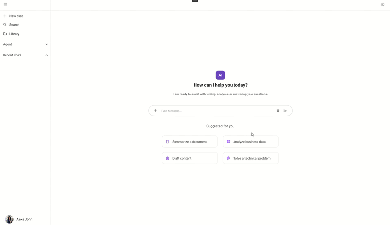

# AI Chat Sample



A .NET MAUI multi-agent chat sample built with Syncfusion controls. It demonstrates agent creation and configuration, chat navigation, follow-up suggestions, voice input (native on Windows only), and switching between a local mock AI service and Azure OpenAI.

## Overview

The sample presents a chat workspace with recent conversations, search, library, profile, and agent configuration areas. Agents have names, descriptions, instructions, colors, initials, and optional avatar images. Agent instructions are sent to Azure OpenAI as the system message for chat requests.

## AI Capabilities

### Agent-Based Chat Responses
- Each prompt is sent through `IAIService.GetResponseAsync`. The active agent's instructions are sent as the system message, so Code Reviewer, Social Media Writer, Meeting notes assistant, and any custom agent each answer in their own role.
- Only the system message and the latest user message are sent for each request. Earlier messages in the chat are not included in the call.
- In the `SfAIAssistView` agent selector, choosing an agent makes its instructions the system message for the next prompt.
- The reply is parsed as a `ContextSuggestionResponse` (`answer` and `suggestions`). If the model returns a JSON object, its `answer` is shown. If the model returns plain text or invalid JSON, the full text is shown as the answer.
- The chat request does not ask the model for JSON, so the model returns `suggestions` only if it does so on its own.
- When an image is attached, the file name is added to the prompt as `[Attached: <file name>]`. The file content is not sent to the AI.

### AI-Drafted Agents
- On the New agent page, the user describes the agent they want. `DraftAgentAsync` returns an `AgentDraft` with a name, a one-sentence description, and system-style instructions.
- The system prompt asks the model for one JSON object: `name` (60 characters or fewer, Title Case), `description` (one sentence, 180 characters or fewer), and `instructions` (one to three short paragraphs in second person).
- The parser takes the first JSON object found in the reply. It still works if the model adds extra text or code fences, and it ignores the case of property names.
- When a draft is ready, the app opens the Configure Agent page with the name, description, and instructions already filled in. The user can edit any field before creating the agent.
- The Configure Agent page has its own `SfAIAssistView`. A prompt typed there fills Agent Name, Description, and Instructions in place, without leaving the page.
- If the model returns nothing usable, the assistant says it could not draft an agent and suggests adding more detail.

### Offline Mock Service
- If the Azure OpenAI environment variables are missing, or the endpoint is not HTTPS, the app registers `MockAIService`. The sample then runs without any configuration.
- The mock waits 400 ms to simulate a request. Its reply starts with `(Mock)`, adds a note when an agent is active, and repeats the text the user typed.
- The mock also returns four fixed suggestion phrases: "Tell me more", "Give an example", "Why?", and "Summarize this". The chat stores them in its suggestion list, but the list is only shown on the welcome screen, so they are not displayed during a conversation.
- For agent drafts, the mock builds the name from the first word of the prompt that has at least three characters, followed by "Specialist". It uses the prompt as the description and writes short generic instructions.

### Error and Timeout Handling
- Azure requests stop after the time set in `AZURE_OPENAI_TIMEOUT_SECONDS` (100 seconds by default). On timeout, the chat shows a message with the number of seconds.
- Other Azure errors appear in the chat as an `Error:` message, so the user is not left waiting.
- If a request is cancelled, nothing is added to the chat.
- If an agent draft fails in Azure mode, the page shows the "couldn't draft an agent" message instead of a draft.

## Key Features

### Navigation Drawer
The `AIChatNavigationPanel` is shown on every page.
- A primary `SfListView` holds **New chat**, **Search**, and **Library**.
- Two `SfExpander` sections hold the **Agent** list, with a **New agent** `SfButton`, and the **Recent chats** list.
- A user row with an `SfAvatarView` and the user's name opens the Profile page when tapped.
- The burger icon collapses the drawer to a narrow icon strip (60 px instead of 250 px). On Android, the collapsed drawer is hidden and the content uses the full width.

### Chat Workspace
- The New chat page uses `SfAIAssistView` with a custom message box (`AIChatInputEditor`). The box has attach, microphone, and send buttons, and pressing Enter also sends.
- The welcome screen shows "How can I help you today?" and a "Suggested for you" grid of four starter prompts: "Summarize a document", "Analyze business data", "Draft content", and "Solve a technical problem". Tapping one sends it. The grid is hidden once the chat has messages, and in agent chats.
- An agent chat shows the agent's avatar, name, and description in the header.
- A loader is shown while a reply is pending, and the send button is disabled until the reply arrives.
- The attach button opens the file picker for images. The file name appears above the message box and can be removed before sending.
- The microphone button adds the recognized text to the message box so the user can edit it before sending. Windows uses native speech recognition in dictation mode. Other platforms, and Windows when recognition fails, show a "Voice input" text dialog instead.

### Agents
- The drawer opens a chat with Meeting notes assistant, Code Reviewer, Social Media Writer, or any agent the user created. Each agent has its own instructions.
- The New agent page shows three **Template** cards (Research agent, Customer support agent, Data analysis agent) and a **My Agents** row in `SfListView` grids. The grids use one, two, or three columns on phone, tablet, and desktop.
- Tapping a card opens the Configure Agent page and fills in the card's name and description.
- The Configure Agent page has **Configure** and **Preview** modes, switched with an `SfChipGroup`. The fields are Agent Name, Description, Instructions, and Company name. Preview shows the logo, name, and description. On phones, the prompt column is set to zero width, so the form fills the page.
- **Create Agent** (`SfButton`) is enabled only when the name and instructions are filled in. It shows "Creating..." while it works, rejects a name that already exists, and shows an "Agent created" message on success.
- A new agent appears in the drawer's Agent list, in My Agents, and in the agent selector of the chat.

### Agent Logo Editor
- Tapping the avatar circle on the Configure Agent page opens the logo editor, built with `SfButton` and `SfListView`.
- The **Create** tab offers ten icons (Image, Idea, Information, Checklist, Document, Institution, Puzzle, Headset, Flow, Users) and six colors (Pink, Yellow, Green, Blue, Red, Purple).
- The **Upload** tab picks a PNG, JPG, JPEG, or SVG file from the device. **Remove Image** clears the choice.
- **Apply** saves the logo. **Cancel** and the close button discard the changes.
- An agent with no custom logo shows the first letter of its name on a color chosen from the name.

### Recent Chats and Search
- A chat session is created when the user sends the first prompt. Its title is that prompt, cut at 80 characters.
- Sessions with no user message are not listed. The list is sorted by last activity, with times such as `now`, `5m`, `2h`, or `3d`.
- The Search page lists the same chats. The search box filters them by title as the user types.
- Each row has a share icon and a more icon. Share opens an `SfPopup` with **Copy Chat**, which copies an `aichat://` link to the clipboard. More opens an `SfPopup` with **Open** and **Delete**, and Delete asks for confirmation first.

### Profile and Library
- The Profile page edits the display name and email and saves them with an `SfButton`. The name is required and the email must contain `@`. After saving, the drawer shows the new name.
- The Library page shows a grid of sample images in an `SfListView`, with two, three, or four columns on phone, tablet, and desktop.

### Theming and Data
- Pages use light and dark colors that follow the device theme.
- Agents, chats, and the profile are held in memory. Restarting the app resets them.

## Application Workflow

1. `MauiProgram` initializes in-memory agent, chat, and profile services.
2. The user selects or creates an agent.
3. The user enters a prompt or selects a suggested action.
4. `AIMainLayoutViewModel`/chat view models add the request to the active session.
5. `IAIService` sends the prompt through Azure OpenAI or `MockAIService`.
6. The response is parsed into answer and follow-up suggestion data.
7. The chat UI updates the active session and navigation state.

## AI Workflow

```text
User Prompt
    ↓
Active Agent Configuration
    ↓
IAIService
    ↓
AzureOpenAIService or MockAIService
    ↓
ContextSuggestionResponse
    ↓
Chat UI and Follow-up Suggestions
```

## AI Architecture

- **Views:** `Views/` contains chat, agent, library, profile, search, and navigation pages.
- **ViewModels:** `ViewModel/` contains chat layout, agent configuration, suggestions, and library logic.
- **Models:** `Models/` contains agent, chat session, navigation, profile, and library data.
- **Services:** `Services/` contains in-memory agent, chat, and helper services.
- **AI:** `AIService/` contains `IAIService`, Azure and mock implementations, and response data.

Data is kept in memory. Restarting the app resets agents, profiles, and chat sessions.

## Syncfusion Controls Used

- `SfAIAssistView` for chat interactions.
- `SfListView` for agent and navigation collections.
- `SfExpander` for configuration sections.
- `SfPopup` for branding and editor dialogs.
- `SfChipGroup` for configuration selections.
- `SfAvatarView` for agent avatars.
- `SfButton` for actions.
- `SfTextInputLayout` for search and agent form fields.

## Prerequisites

- .NET 10 SDK.
- A .NET MAUI workload for the target platform.
- The Syncfusion and Azure NuGet packages referenced by `AIChatSample.csproj`.
- Azure OpenAI credentials only for live AI responses.

## Configuration

### AI Configuration

Azure OpenAI is selected only when all required values are valid HTTPS environment variables. Otherwise `MockAIService` is registered.

| Variable | Required | Purpose |
| --- | --- | --- |
| `AZURE_OPENAI_ENDPOINT` | Azure mode | HTTPS Azure OpenAI endpoint |
| `AZURE_OPENAI_KEY` | Azure mode | Azure OpenAI API key |
| `AZURE_OPENAI_DEPLOYMENT` | Azure mode | Chat deployment name |
| `AZURE_OPENAI_TIMEOUT_SECONDS` | No | Request timeout; defaults to 100 seconds |

Do not commit API keys to source control.

### Supported Target Frameworks

- `net10.0-android`
- `net10.0-ios` and `net10.0-maccatalyst` (not available when building on Linux)
- `net10.0-windows10.0.19041.0` (Windows hosts only)

## Getting Started

Run from `Use Case Samples/AI Chat Sample/AIChatSample` (the folder containing `AIChatSample.slnx`):

```sh
dotnet restore AIChatSample/AIChatSample.csproj

dotnet build AIChatSample/AIChatSample.csproj -t:Run -f net10.0-android
dotnet build AIChatSample/AIChatSample.csproj -t:Run -f net10.0-ios
dotnet build AIChatSample/AIChatSample.csproj -t:Run -f net10.0-maccatalyst
dotnet build AIChatSample/AIChatSample.csproj -t:Run -f net10.0-windows10.0.19041.0
```

Set the Azure environment variables before starting the app to use live Azure responses.

## Project Structure

```text
AIChatSample/
└── AIChatSample/
    ├── AIService/
    ├── Controls/
    ├── Converters/
    ├── Models/
    ├── Platforms/
    ├── Resources/
    ├── Services/
    ├── Styles/
    ├── Themes/
    ├── ViewModel/
    ├── Views/
    ├── App.xaml
    ├── AppShell.xaml
    └── MauiProgram.cs
```

## Troubleshooting

- **Mock service is used:** Verify the endpoint, key, and deployment environment variables.
- **Azure endpoint is rejected:** The endpoint must be an absolute HTTPS URL.
- **Chat state resets:** Agent and chat state is intentionally in memory.
- **Path Too Long on Windows:** Use a shorter repository path.

## Responsible AI Considerations

- Agent instructions and user prompts are sent to Azure OpenAI in live mode.
- Do not include sensitive or confidential information in prompts.
- Review Azure OpenAI deployment and data-handling settings for production use.

## Related Documentation

- [Syncfusion AIAssistView for .NET MAUI](https://help.syncfusion.com/maui/aiassistview/getting-started)
- [.NET MAUI Documentation](https://learn.microsoft.com/dotnet/maui/)
- [Azure OpenAI Documentation](https://learn.microsoft.com/azure/ai-services/openai/)

## Supported Platforms

- Android
- iOS
- macOS (Mac Catalyst)
- Windows

## License

This sample is provided for demonstration purposes. Syncfusion controls require a valid Syncfusion license for production use.
