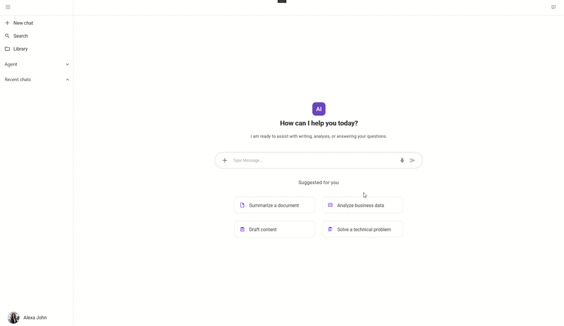

# AI Chat Sample

## Sample Title

**AI Chat Sample**  
A customizable multi-agent AI chat experience that demonstrates agent creation, branding, and conversational AI interactions using .NET MAUI and Syncfusion controls.

---

## Overview

The AI Chat Sample showcases how to build a modern conversational AI application where users can configure and interact with multiple AI agents, each with its own identity, branding, and chat history.

The sample demonstrates how Syncfusion's AI-focused controls can be combined with Azure OpenAI or a mock AI service to deliver a rich cross-platform chat experience.

### What the sample does

- Provides a multi-agent AI chat interface.
- Allows users to create, customize, and manage AI agents.
- Supports agent avatars, branding, and chat sessions.
- Displays AI responses using a modern chat experience.

### Who it is for

- .NET MAUI developers
- Application architects
- Developers evaluating Syncfusion AI UI components
- Teams building conversational AI applications

### What AI capability it uses

- AI-powered conversational chat
- Agent configuration and persona management
- Context-aware response generation
- Suggested follow-up interactions

### What outcome the user gets

- Interactive conversations with configurable AI agents
- Consistent chat experience across platforms
- Easy integration with Azure OpenAI
- A reusable architecture for AI-powered assistant applications

---

## Key Features

- Multi-agent chat experience with customizable personas
- Agent branding, avatar, and logo customization
- Follow-up suggestions and conversational workflows
- Azure OpenAI integration with mock AI fallback support

---

## AI Flow

1. User enters a prompt or selects a suggested action.
2. The application gathers the active agent configuration and chat context.
3. The AI service processes the request.
4. The application receives and interprets the AI response.
5. The response is displayed within the chat interface.
6. If AI configuration is unavailable or invalid, the application falls back to the mock AI service.

---

## Controls Used

- `SfAIAssistView` - Provides the conversational AI chat experience.
- `SfListView` - Displays agent lists and navigation content.
- `SfExpander` - Organizes collapsible sections.
- `SfPopup` - Hosts avatar and branding editors.
- `SfChipGroup` - Switches configuration modes.
- `SfAvatarView` - Displays agent avatars.
- `SfButton` - Executes primary actions.

---

## Architecture

- View / Page
- ViewModel
- AI Service
- Models
- Supporting UI Components

### Data Flow

```text
User Input
     ↓
 ViewModel
     ↓
  AI Service
     ↓
AI Response
     ↓
 Syncfusion UI
```

---

## Prerequisites

- .NET 10.0 SDK
- MAUI workload
- Visual Studio 2026 or later
- Syncfusion MAUI packages
- Optional Azure OpenAI account

---

## AI Configuration

### Default Behavior

- Mock AI Service (default)
- Azure OpenAI Service (optional)

### Environment Variables / Secrets

| Variable | Required | Description |
|----------|----------|-------------|
| AZURE_OPENAI_ENDPOINT | Yes | Azure OpenAI endpoint URL |
| AZURE_OPENAI_KEY | Yes | Azure OpenAI API key |
| AZURE_OPENAI_DEPLOYMENT | Yes | Azure OpenAI deployment name |
| AZURE_OPENAI_TIMEOUT_SECONDS | Optional | Optional timeout |

### Notes

- Do not commit API keys to source control.
- Use environment variables or secure storage.
- Missing configuration falls back to MockAIService.

---

## Run

### Android

```bash
dotnet build AIChatSample.slnx -t:Run -f net10.0-android
```

### Windows

```bash
dotnet build AIChatSample.slnx -t:Run -f net10.0-windows10.0.19041.0
```

---

## Output



---

## Project Structure

```text
Views/
ViewModels/
Models/
Services/
Resources/
```

- `Views/` - UI pages and layouts
- `ViewModels/` - Presentation logic
- `Models/` - Data structures
- `Services/` - AI services
- `Resources/` - Styles and assets

---

## Troubleshooting

### Path too long exception

If you encounter a "Path Too Long" exception while building the project, close Visual Studio, rename the repository folder to a shorter name, and rebuild the project.

## License

Syncfusion has no liability for any damage or consequence that may arise from using or viewing the samples. The samples are for demonstrative purposes. If you choose to use or access the samples, you agree to not hold Syncfusion liable, in any form, for any damage related to use, for accessing, or viewing the samples. By accessing, viewing, or seeing the samples, you acknowledge and agree Syncfusion's samples will not allow you seek injunctive relief in any form for any claim related to the sample. If you do not agree to this, do not view, access, utilize, or otherwise do anything with Syncfusion's samples.