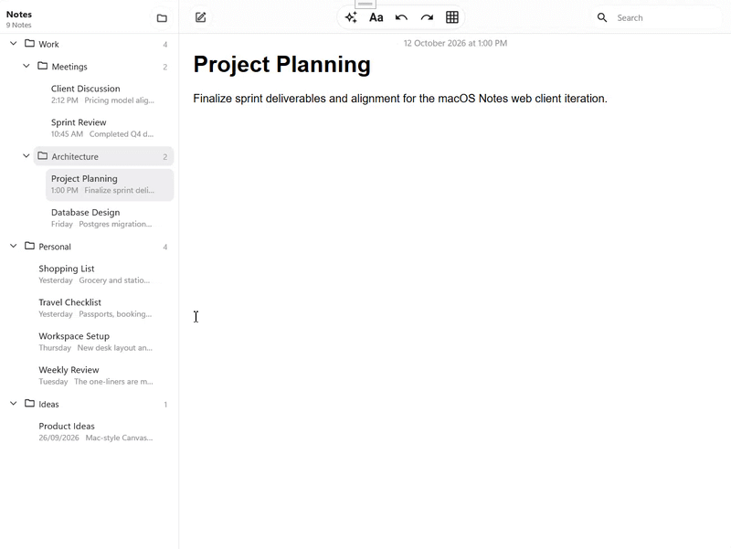

# AI-Powered Maui Notes



A cross-platform .NET MAUI notes application that combines a custom rich-text editor adapter with Azure OpenAI writing actions.

## Overview

Users organize folders and notes, edit rich text, and request AI transformations for a selection or the full note. The app applies guarded replacements and allows cancellation, revert, retry, undo, and redo.

## AI Capabilities

### Writing Actions
The **AI assistant** button on the editor toolbar opens a writing tools popup (`SfPopup`) with ten actions. Each action sends a fixed instruction to Azure OpenAI.
- **Grammar** checks grammar, spelling, and punctuation, and keeps the meaning and tone.
- **Proofread** corrects grammar, spelling, and punctuation, and keeps the meaning and tone.
- **Rewrite** improves clarity and flow, and keeps the meaning and important details.
- **Friendly**, **Professional**, and **Concise** change the tone or length of the text. Friendly is warm. Professional is polished. Concise keeps only the essential information.
- **Summary** makes a short summary of the text.
- **Key Points** turns the text into a short bullet list and adds no new facts.
- **List** and **Table** convert the content into an HTML list or an HTML table with a header row. They add no new facts.

### Custom Instructions
- The popup has a **Describe your change** box. The user can type any instruction, for example "make this shorter and add a title".
- The send button next to the box is enabled only when the box has text.
- The custom text is sent as the requested change in place of a built-in instruction.

### Selection or Whole Note
- If the user has selected text, only that text is sent and only that range is replaced.
- If nothing is selected, the whole note is sent, including its title. The AI result then replaces the whole note.
- The request carries both the plain text and the HTML of the target. The AI is asked to keep the headings, links, and inline formatting that are already in the source.
- Requests are limited to 20,000 characters of text. Larger input is rejected with a message.

### Prompt and Output Rules
- The system message tells the model to edit only the note content and to treat the note text and the custom instruction as data, not as commands that override its rules.
- The model must return only an HTML fragment that uses headings, paragraphs, lists, tables, `strong`, `em`, `u`, links, and `span`. It must not add scripts, styles, event handlers, comments, or facts that are not in the source.
- The reply is limited to 2,000 output tokens.
- Before the result is inserted, the app removes Markdown code fences if the model added them. It also fixes HTML that came back with escaped angle brackets.

### Safe Apply, Review, and Recovery
- The editor is read-only while a request runs, so the text cannot change under the request.
- Before applying a result, the app checks that the same note is still selected, that the note is not locked, and that its content has not changed. If any check fails, nothing is applied and a message explains why.
- The editor adapter also rejects a result if the selected range changed since it was captured.
- After a result is applied, a review popup shows **Revert**, **Retry**, **Undo**, **Redo**, **Done**, and **Cancel**. Revert restores the original text and Retry restores it and runs the same action again. Undo and Redo use the editor history, and Done keeps the result.
- While a request runs, the review popup shows a progress indicator. **Cancel** stops the request.
- If a newer request replaces an older one, the older response is ignored.

### Errors and Configuration
- Azure OpenAI is called with an `api-key` header, through the `openai/v1/chat/completions` route of the configured endpoint. The endpoint must be HTTPS and a deployment name is required.
- Specific messages are shown for rejected credentials (401 or 403), a missing deployment or route (404), a busy or over-quota deployment (429), and any other HTTP error.
- Empty or unreadable replies, timeouts (the `HttpClient` limit is 60 seconds), and cancellations also show clear messages in the popup.
- AI actions are disabled when no note is selected or the note is locked.
- The app has no offline AI fallback. Without Azure OpenAI settings, the notes still work and AI actions show an error.

## Key Features

### Folders and Notes
- Notes are kept in folders and subfolders in an `SfTreeView`. Each folder shows how many notes it holds.
- The tree has a **New folder** button. Each row has a menu. The note menu has **Create**, **Move To**, **Lock** or **Unlock**, **Duplicate**, and **Delete**. The folder menu has **New Subfolder**, **Move To**, **Rename**, and **Delete**.
- **Move To** opens a list of destination folders. On desktop, items can also be moved by drag and drop in the tree.
- Rename checks the new name. For example, a folder name cannot be empty.
- Deleting a note or folder asks for confirmation first.
- A note's title is always the first line of its content. Each row also shows a time or date, a short preview, and a **Locked** label for locked notes.
- On first run the app creates sample folders and notes (Work, Personal, and Ideas).

### Note Search
- The search box filters the tree as the user types, and matching folders are expanded.
- On narrow desktop windows, the search box collapses into an icon.

### Rich Text Editing
- `CustomRichTextEditor` wraps `SfRichTextEditor` with its own toolbar. The editor toolbar is an `SfToolbar` with **AI assistant**, **Text styles**, **Undo**, **Redo**, and **Insert table**.
- **Text styles** opens a popup with Bold, Italic, Underline, Strikethrough, highlight, and text color buttons. It also lists Title, Heading, Subheading, Body, Monostyled, Bulleted List, and Numbered List.
- The text color popup offers Purple, Pink, Orange, Mint, and Blue. The highlight popup offers Yellow, Green, Blue, Pink, and Orange.
- Buttons show whether the current text already has a format.
- **Insert table** adds a table to the note.
- A full timestamp, for example "21 September 2026 at 3:08 PM", is shown above the editor.
- A locked note is read-only.

### Saving
- Changes are saved automatically about 0.4 seconds after the user stops, to `maui-notes.json` in the app data folder. The file is written to a temporary file first and then moved into place.
- The app restores the folders, notes, and the last selected note and folder on the next start.
- A file that is damaged or has an unsupported version is rejected, and the app starts with the sample notes instead. Save and load messages are shown on the Android notes list page.

### Layout by Platform
- On Windows, macOS (Mac Catalyst), and iOS, the app shows two columns: a 256 px folder tree and the editor.
- On Android, the app shows a notes list page. Opening a note goes to a separate editor page that has back and new note buttons.

## Application Workflow

1. The user selects text or chooses an AI action for the full note.
2. `NotesViewModel` captures the selection, HTML, and plain-text context.
3. `IAiEditingService` sends the editing request to Azure OpenAI.
4. The response is validated against the requested selection and source state.
5. `CustomRichTextEditor` applies or restores the returned HTML.
6. `JsonNotePersistenceService` persists note changes.

## AI Workflow

```text
Selected Text or Full Note
    ↓
NotesViewModel
    ↓
AzureOpenAiEditingService
    ↓
Azure OpenAI Chat Completions
    ↓
Validated HTML Replacement
    ↓
Editor Update or Revert
```

## AI Architecture

- **Views:** Desktop/mobile notes and editor pages.
- **ViewModels:** `NotesViewModel` and partial view-model files.
- **Models:** Note, folder, AI action, and AI request data.
- **AI:** `IAiEditingService` and `AzureOpenAiEditingService`.
- **Persistence:** `INotePersistenceService` and `JsonNotePersistenceService`.
- **Editor:** `CustomRichTextEditor` project handles selection and HTML replacement.

## Syncfusion Controls Used

- `SfRichTextEditor`
- `SfTreeView`
- `SfPopup`
- `SfToolbar`
- `SfButton`

## Prerequisites

- .NET 10 SDK.
- .NET MAUI workloads for target platforms.
- Syncfusion package versions referenced by `MauiNotes.csproj` and `CustomRichTextEditor.csproj`.
- An Azure OpenAI chat deployment for live AI editing.

## Configuration

### AI Configuration

Set these environment variables before launch:

| Variable | Required | Purpose |
| --- | --- | --- |
| `MAUINOTES_AZURE_OPENAI_ENDPOINT` | Live AI | HTTPS Azure OpenAI endpoint |
| `MAUINOTES_AZURE_OPENAI_API_KEY` | Live AI | Azure OpenAI API key |
| `MAUINOTES_AZURE_OPENAI_DEPLOYMENT` | Live AI | Deployed chat model |
| `SYNCFUSION_LICENSE_KEY` | Production licensing | Syncfusion license key, read at startup in `MauiProgram.cs` |

The current `HttpClient` timeout is 60 seconds in `MauiProgram.cs`.

Notes remain usable when AI configuration is missing, but AI actions return configuration errors. The service calls the `openai/v1/chat/completions` route under the configured endpoint.

## Getting Started

Run from `Use Case Samples/AI-Powered Maui Notes/MauiNotes` (the folder containing `MauiNotes.slnx`):

```sh
dotnet restore MauiNotes.slnx

dotnet build MauiNotes/MauiNotes.csproj -t:Run -f net10.0-android
dotnet build MauiNotes/MauiNotes.csproj -t:Run -f net10.0-ios
dotnet build MauiNotes/MauiNotes.csproj -t:Run -f net10.0-maccatalyst
dotnet build MauiNotes/MauiNotes.csproj -t:Run -f net10.0-windows10.0.19041.0
```

## Project Structure

```text
MauiNotes/
├── CustomRichTextEditor/
└── MauiNotes/
    ├── Controls/
    ├── Models/
    ├── Platforms/
    ├── Resources/
    ├── Services/
    ├── ViewModels/
    ├── Views/
    ├── App.xaml
    ├── AppShell.xaml
    └── MauiProgram.cs
```

## Troubleshooting

- **AI action is unavailable:** Set all three Azure OpenAI variables.
- **AI response is not applied:** The note or selection may have changed while the request was running.
- **Build fails:** Verify .NET 10 workloads and Syncfusion package compatibility.

## Responsible AI Considerations

- Send only note content required for the requested edit.
- Do not include confidential text in AI prompts.
- Review Azure OpenAI data handling before using sensitive notes.

## Related Documentation

- [Syncfusion RichTextEditor for .NET MAUI](https://help.syncfusion.com/maui/rich-text-editor/getting-started)
- [.NET MAUI Documentation](https://learn.microsoft.com/dotnet/maui/)
- [Azure OpenAI Documentation](https://learn.microsoft.com/azure/ai-services/openai/)

## Supported Platforms

- Android
- iOS
- macOS (Mac Catalyst)
- Windows

## License

Syncfusion controls require a valid license for production use.
