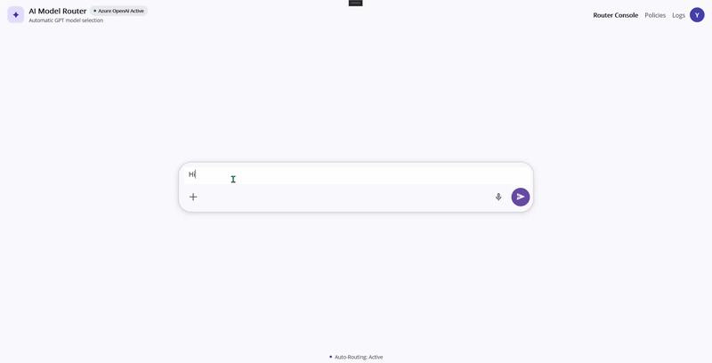

# LLM Routing

A .NET MAUI chat sample that classifies each query and routes it to an Azure OpenAI model tier, displaying the selected model and response in chat.

## Overview

Different queries may need different model capabilities. This sample uses a low-tier Azure OpenAI model to classify a user's request as `LOW`, `STANDARD`, or `HIGH`, then routes the request to the corresponding model. The chat UI identifies the selected model and shows the response, token counts, and estimated cost. The sample also supports image attachments for the answer-generation step.

- **What it does:** Routes text or image-assisted questions to one of three configured Azure OpenAI models.
- **Who it is for:** Users interacting with an AI chat and developers exploring model-tier routing in a .NET MAUI app.
- **AI capability:** Azure OpenAI chat completions, model-based complexity classification, and image input on the routed answer request.
- **Outcome:** A response from the selected model, accompanied by its model name, token usage, and estimated cost.

## Key Features

- Automatic query classification into low, standard, or high tiers.
- Routing to `gpt-4.1-nano`, `gpt-4.1-mini`, or `gpt-5.6-luna`.
- Image attachments included with the user's question when an eligible image is attached.
- Response chat bubbles display the selected model, Markdown-rendered output, token counts, and estimated cost.

## AI Flow

1. The user sends a query in the chat, optionally with an image attachment.
2. `MainPageViewModel` adds the request and a status response to the conversation, and the service prepares the routing classification prompt.
3. The low-tier `gpt-4.1-nano` client classifies the query as `LOW`, `STANDARD`, or `HIGH`.
4. The ViewModel maps the selected tier to its model, then sends the query (and an eligible attached image, if present) to that model for a response.
5. The result is displayed in the response bubble with the selected model, token usage, and estimated cost.
6. If an AI request fails, the chat displays an error asking the user to check Azure OpenAI configuration and availability; there is no generated mock-response fallback.

## Controls Used

- `SfAIAssistView` — provides the chat conversation, message composer, attachment picker, and voice input UI.
- `SfMarkdownViewer` — renders the model response as Markdown.
- MAUI `ActivityIndicator` — indicates that the request is being processed.

## Architecture

- **View:** `MainPage.xaml` provides the chat layout and response template; `MainPage.xaml.cs` handles the AssistView request event.
- **ViewModel:** `MainPageViewModel` adds chat items, invokes routing and generation, reads eligible image attachments, and exposes response metadata.
- **AI service:** `AzureOpenAIService` builds model clients, classifies queries using the low model, and generates text or image-assisted responses.
- **Models:** `AIAssistResponseItem` stores the model header, response, token counts, and cost display values.
- **Supporting services:** `CostCalculator` estimates and formats cost; `AIAssistTemplateSelector` selects the custom response template.
- **Startup:** `MauiProgram` configures Syncfusion and registers the Azure OpenAI service and ViewModel.

## Prerequisites

- .NET 10 SDK (the project targets `net10.0`).
- .NET MAUI workload for the target platform. The project always targets Android, adds iOS and Mac Catalyst outside Linux, and adds Windows on Windows.
- Visual Studio version is not specified in the project.
- Syncfusion MAUI AIAssistView, Core, and MarkdownViewer packages are referenced with wildcard package versions. The project does not show a Syncfusion license-key registration in `MauiProgram.cs`.
- Azure OpenAI account/deployments and credentials are required for routing and response generation. The configured deployments must match the model names used by the code.

## AI Configuration

`AzureOpenAIService` reads credential environment variables when it creates the three model clients. For each model, it checks the model-specific endpoint/key first, then shared values, and finally code-defined placeholder values. Model-specific suffixes use uppercase model names with punctuation converted to underscores. For example, the nano model uses `AZURE_API_BASE_GPT_4_1_NANO` and `AZURE_API_KEY_GPT_4_1_NANO`.

Cost rates are read from optional per-model environment variables. If a rate is not set or cannot be parsed, the service uses the defaults in `CostCalculator`.

## Default Behavior

- **Real cloud AI:** Both classification and answer generation call Azure OpenAI.
- **Mock AI:** No mock AI response is implemented.
- **Local/offline logic:** Tier-to-model selection, eligible image attachment loading, and cost estimation run locally. The placeholder endpoint and API key do not provide offline responses; valid credentials are required for API calls.
- **Failure behavior:** Exceptions are shown as an error message in the chat response. There is no automatic retry or local answer fallback.

## Environment Variables / Secrets

Per-model credentials are optional if shared credentials are configured. The exact model suffix is shown below:

| Variable | Purpose |
| --- | --- |
| `AZURE_API_BASE_<MODEL>` | Optional per-model Azure OpenAI endpoint. |
| `AZURE_API_KEY_<MODEL>` | Optional per-model Azure OpenAI API key. |
| `AZURE_API_BASE` | Shared Azure OpenAI endpoint fallback. |
| `AZURE_API_KEY` | Shared Azure OpenAI API key fallback. |
| `AZURE_PRICE_INPUT_<MODEL>` | Optional USD price per 1K input tokens. |
| `AZURE_PRICE_OUTPUT_<MODEL>` | Optional USD price per 1K output tokens. |

For example, model-specific variables include `AZURE_API_BASE_GPT_4_1_NANO`, `AZURE_API_KEY_GPT_4_1_MINI`, `AZURE_PRICE_INPUT_GPT_4_1_NANO`, and `AZURE_PRICE_OUTPUT_GPT_4_1_MINI`. The code's high-tier model identifier is `gpt-5.6-luna`; derive its suffix from that exact identifier (`GPT_5_6_LUNA`).

### Notes

- Do not commit API keys to source control.
- Supply keys via environment variables or an appropriate secrets manager; the sample reads environment variables directly.
- If no real credentials are configured, placeholder values are used to construct clients, but requests will fail; the chat displays an error rather than returning local mock results.
- Per-model price variables are optional; built-in rates are used otherwise.

## Run

Run commands from the `Use Case Samples/LLM_Routing` directory. Restore and build/run for a platform supported by the current host and installed MAUI workload:

```sh
dotnet workload restore
dotnet restore LLM_Routing/LLM_Routing.csproj

# Android
dotnet build LLM_Routing/LLM_Routing.csproj -t:Run -f net10.0-android

# iOS (macOS host)
dotnet build LLM_Routing/LLM_Routing.csproj -t:Run -f net10.0-ios

# Mac Catalyst (macOS host)
dotnet build LLM_Routing/LLM_Routing.csproj -t:Run -f net10.0-maccatalyst

# Windows (Windows host)
dotnet build LLM_Routing/LLM_Routing.csproj -t:Run -f net10.0-windows10.0.19041.0
```

## Output

The UI is an AI chat titled “AI Model Router”. It shows user queries and responses, indicates routing and generation progress, displays the chosen model in each assistant response, and shows input/output token counts and estimated cost.



## Project Structure

- `LLM_Routing/MainPage.xaml` and `MainPage.xaml.cs` — chat UI and AssistView request handling.
- `LLM_Routing/ViewModels/` — presentation and chat orchestration logic.
- `LLM_Routing/Models/` — chat response data structure.
- `LLM_Routing/Services/AzureOpenAIService.cs` — model classification and response generation.
- `LLM_Routing/Services/CostCalculator.cs` — token-cost estimation and formatting.
- `LLM_Routing/Services/AIAssistTemplateSelector.cs` — response template selection.
- `LLM_Routing/Resources/` — app icon, fonts, splash, and styles.
- `LLM_Routing/Platforms/` and `Converters/` — platform files and XAML converters.

## Troubleshooting

**Issue: Azure OpenAI requests fail**
**Cause:** Model-specific and shared endpoint/key variables are missing, placeholders are in use, or the deployment names do not match the service configuration.
**Fix:** Set valid model-specific credentials or shared `AZURE_API_BASE` and `AZURE_API_KEY`, confirm the endpoint and model deployments, and restart the app.

**Issue: Build or workload errors**
**Cause:** .NET 10 SDK or a target MAUI workload is missing, or the target is unsupported on the current host.
**Fix:** Verify the SDK and install/restore the required workload. Build iOS and Mac Catalyst on macOS, and Windows on Windows.

**Issue: A query is routed to an unexpected model**
**Cause:** The low-tier classifier returned a different tier than expected; any unrecognized or empty tier defaults to the low model.
**Fix:** Review the classification prompt and query sent to the router, then confirm the low-model deployment and configuration.

**Issue: The shown cost differs from billing**
**Cause:** Built-in rates may not match the Azure billing plan.
**Fix:** Set `AZURE_PRICE_INPUT_<MODEL>` and `AZURE_PRICE_OUTPUT_<MODEL>` for each model using USD per 1K tokens.

## Security and Privacy Notes

- Do not hard-code API keys or commit them to source control.
- User queries and, when attached, image data are sent to Azure OpenAI. Avoid including unnecessary sensitive data.
- The router sends the query to the low-tier classifier and then sends the query to the selected response model; keep the prompt content limited to what is needed.
- Use a secure secrets mechanism to provision environment variables in deployment environments.
- Review Azure endpoint, model deployment, and data handling settings for the external service.

## Supported Platforms

- Android
- iOS (project adds this target outside Linux)
- Windows (when building on Windows)
- Mac Catalyst (project adds this target outside Linux)

## License

No project-specific license or Syncfusion license registration is specified in the sample files. Syncfusion packages are referenced by the project; review the applicable Syncfusion licensing terms for use of those packages.
