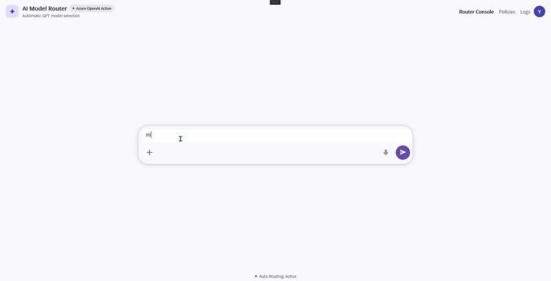

# LLM Routing



A .NET MAUI chat sample that uses `gpt-4.1-nano` to classify query complexity, then routes the request to `gpt-4.1-nano`, `gpt-4.1-mini`, or `gpt-5.6-luna`.

## Overview

The chat adds the selected model, input/output token counts, estimated cost, and generated text to each response. A supported image attachment can be sent with the routed query.

## AI Capabilities

### Query Complexity Routing
- Every message is first sent to `gpt-4.1-nano`, which acts as a router. The system prompt asks it to put the query into one of three tiers, LOW, STANDARD, or HIGH, and to reply with only the label.
- The query is wrapped in `<query>` tags in the user message. The prompt gives no other rules for choosing a tier, so the choice is left to the model.
- LOW maps to `gpt-4.1-nano`, STANDARD maps to `gpt-4.1-mini`, and HIGH maps to `gpt-5.6-luna`. Any other reply goes to `gpt-4.1-nano`.
- Simple questions stay on the smallest model and only hard questions use the most expensive one. This keeps the cost of a chat low.
- The router sees only the text of the message. It does not see an attached image.
- Each message is classified on its own. Earlier messages in the chat are not sent.

### Answer Generation
- The routed model answers with the system message "You are a helpful AI assistant. Answer accurately and concisely."
- Only the current message is sent, so the chat has no memory of earlier turns.
- Each model uses its own `ChatClient`. A model can use its own Azure resource, or share one endpoint and key with the others.
- Replies longer than 8,500 characters are cut at that length and end with "(more)…".

### Image Questions
- When the user attaches a PNG, JPG, JPEG, GIF, WEBP, or BMP file, the text and the image are sent together to the routed model with image detail set to `Auto`.
- The system message then asks the model to analyze the attached image and answer the question about it.
- Only the first supported attachment is used. Files over 10 MB, empty files, and other file types are skipped, and the message is then sent as text only.

### Token Usage and Cost Estimate
- Each answer reports the number of input and output tokens returned by Azure OpenAI.
- The estimated cost is `input tokens / 1,000 × input price + output tokens / 1,000 × output price`, shown in US dollars with four decimals when under $0.01, and three decimals above that.
- Built-in prices per 1K tokens are $0.0001 in and $0.0004 out for `gpt-4.1-nano`, $0.0004 and $0.0016 for `gpt-4.1-mini`, and $0.003 and $0.012 for `gpt-5.6-luna`. The `AZURE_PRICE_INPUT_<MODEL>` and `AZURE_PRICE_OUTPUT_<MODEL>` variables replace them.
- The cost covers only the answer call. The classifier call is not counted.

### Errors
- If routing or answer generation fails, the chat shows "Unable to generate a response" with the error details, so the user can fix the Azure configuration.
- If no credentials are set, the service uses a placeholder endpoint and key, and requests fail with this message.

## Key Features

### Chat Interface
- The page is a single `SfAIAssistView` chat. The built-in header and toolbar are turned off. Conversation history is off.
- The composer has an attachment button, and voice input is turned on with `EnableVoiceInput`.
- Chosen files appear as chips above the editor. They stay there until the user sends a message with text, and are cleared after sending.
- Picking a file alone does not send anything.
- The chat scrolls to the last response and shows a scroll-to-bottom button.
- The page has a header ("AI Model Router"), a status line ("Auto-Routing: Active"), and a custom light color theme for the chat.
- On a phone, some header labels are hidden.

### Live Routing Status
- Right after sending, an answer card appears. It first shows "Validating query with low-end model...".
- When the router chooses, the card shows the chosen model name in a pill, and the text changes to "Routed to <model>. Generating response..." or "Routed to <model>. Analyzing attached image...".
- While the model works, the status text is shown with a spinning `ActivityIndicator`. The answer replaces it when it arrives.
- The user can see which model handled each question.

### Answer Cards
- Each answer is shown in a card with a "Copilot Assistant" label and the model pill.
- The answer text is rendered with `SfMarkdownViewer`, so headings, lists, tables, and code blocks display as formatted text. The viewer grows to fit the text, and code uses a light background.
- A readout below the answer shows input tokens, output tokens, and the estimated cost.
- A custom template selector (`AIAssistTemplateSelector`) applies this card to routed answers only.

## Application Workflow

1. The user sends text, optionally with an image attachment.
2. `MainPageViewModel` adds the request and a routing response item.
3. `AzureOpenAIService.SelectModelAsync` uses `gpt-4.1-nano` for classification.
4. The result maps to the low, standard, or high model.
5. The selected model receives text or text-plus-image input.
6. Token counts and cost are calculated and rendered with the response.

## AI Workflow

```text
User Query
    ↓
gpt-4.1-nano Classification
    ↓
LOW / STANDARD / HIGH
    ↓
Selected Azure OpenAI Model
    ↓
Chat Completion
    ↓
Text + Token Usage + Estimated Cost
```

## AI Architecture

- **View:** `MainPage.xaml` and `MainPage.xaml.cs`.
- **ViewModel:** `MainPageViewModel`.
- **Service:** `AzureOpenAIService`.
- **Models:** `AIAssistResponseItem` (in `Models/ChatItems.cs`).
- **Support:** `CostCalculator` and `AIAssistTemplateSelector`.

## Syncfusion Controls Used

- `SfAIAssistView`
- `SfMarkdownViewer`
- MAUI `ActivityIndicator`

## Prerequisites

- .NET 10 SDK.
- A .NET MAUI workload for the target platform.
- Azure OpenAI deployments for the configured model identifiers.
- NuGet packages: `Azure.AI.OpenAI`, `CommunityToolkit.Mvvm`, and Syncfusion AIAssistView, Core, and MarkdownViewer.

## Configuration

### AI Configuration

The service reads shared and per-model environment variables.

| Variable | Purpose |
| --- | --- |
| `AZURE_API_BASE_<MODEL>` | Per-model Azure endpoint |
| `AZURE_API_KEY_<MODEL>` | Per-model Azure API key |
| `AZURE_API_BASE` | Shared endpoint fallback |
| `AZURE_API_KEY` | Shared API-key fallback |
| `AZURE_PRICE_INPUT_<MODEL>` | Optional input price per 1K tokens |
| `AZURE_PRICE_OUTPUT_<MODEL>` | Optional output price per 1K tokens |

The model suffix is the model name uppercased, with every non-alphanumeric character (such as `.`, `-`, or a space) replaced by `_`. Examples include `GPT_4_1_NANO`, `GPT_4_1_MINI`, and `GPT_5_6_LUNA`.

Per-model variables take precedence over the shared ones. Without credentials, the service uses placeholder endpoint/key values and live requests fail. If a price variable is not set, built-in default prices in `CostCalculator` are used.

## Getting Started

Run from `Use Case Samples/LLM_Routing`. The iOS and Mac Catalyst targets build only on macOS, and the Windows target only on Windows:

```sh
dotnet restore LLM_Routing/LLM_Routing.csproj

dotnet build LLM_Routing/LLM_Routing.csproj -t:Run -f net10.0-android
dotnet build LLM_Routing/LLM_Routing.csproj -t:Run -f net10.0-ios
dotnet build LLM_Routing/LLM_Routing.csproj -t:Run -f net10.0-maccatalyst
dotnet build LLM_Routing/LLM_Routing.csproj -t:Run -f net10.0-windows10.0.19041.0
```

## Project Structure

```text
LLM_Routing/
├── Converters/
├── Models/
├── Platforms/
├── Resources/
├── Services/
├── ViewModels/
├── App.xaml
├── AppShell.xaml
├── MainPage.xaml
└── MauiProgram.cs
```

## Troubleshooting

- **Azure request fails:** Verify shared/per-model endpoint and key variables.
- **No image analysis:** Only the first supported image attachment is read; maximum size is 10 MB.
- **Unexpected route:** The low model must return `LOW`, `STANDARD`, or `HIGH`; unknown values route to low tier.
- **Unexpected cost:** Set per-model price variables to match the Azure deployment billing.

## Responsible AI Considerations

- User prompts and attachments are sent to Azure OpenAI.
- Routing sends the query once to the classifier and again to the selected model.
- Do not include sensitive data in prompts or images.

## Related Documentation

- [Syncfusion AIAssistView for .NET MAUI](https://help.syncfusion.com/maui/aiassistview/getting-started)
- [Syncfusion MarkdownViewer for .NET MAUI](https://help.syncfusion.com/maui/markdownviewer/getting-started)
- [Azure OpenAI Documentation](https://learn.microsoft.com/azure/ai-services/openai/)

## Supported Platforms

- Android
- iOS
- macOS (Mac Catalyst)
- Windows

## License

Syncfusion controls require a valid Syncfusion license for production use.
