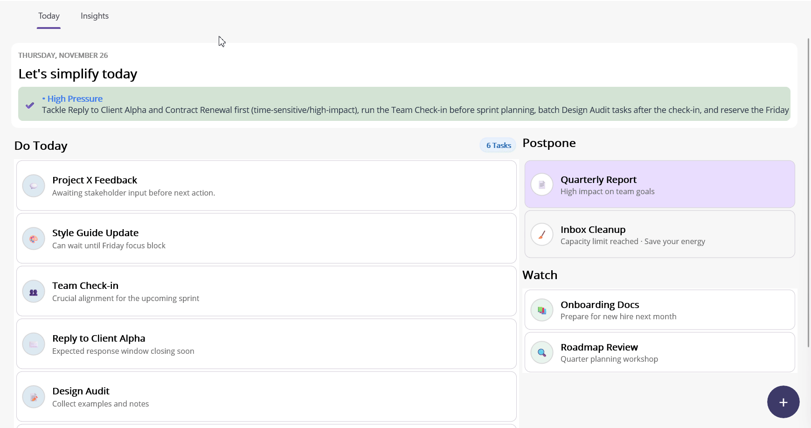

# Smart Daily Decision Companion



A responsive .NET MAUI task-prioritization sample that sends task context to Azure OpenAI and separates tasks into Do Today, Postpone, and Watch groups.

## Overview

`MainViewModel` analyzes the full task list and individual tasks for pressure, focus, urgency, importance, momentum, delay risk, mentorship, and recommendation. It provides accept/postpone actions and ignores stale async insight responses.

## AI Capabilities

All AI calls go through `AzureAIService.GetResultsFromAI`. It sends a fixed system message ("You are a concise task-management assistant. Follow the output format requested by the user exactly and return no preamble.") and the prompt that `MainViewModel` builds. Each reply is limited to 2500 tokens.

### Workload Pressure and Complexity
- `AnalyzePressureAsync` sends the topic and description of every Do Today task and asks for JSON only. The JSON holds a `complexity` (Low, Medium, or High) for each task, an overall `pressure` (Low Pressure, Medium Pressure, or High Pressure), and a `tip`.
- The pressure value is shown as the label in the Today summary card, and the tip is shown below it. The tip is cut to two lines.
- The complexity of each task is stored on the task itself. The user never enters it. It is then passed into the later insight prompts and the focus fallback.
- If the reply is empty, the label stays at "Medium Pressure". If the reply is not valid JSON, the app looks for "high" or "low" in the text to choose the label.

### Task Recommendation
- `AnalyzeRecommendationAsync` sends each Do Today task with its topic, description, and deadline. It asks the model which task to do first and to return only the task topic.
- The reply lines are matched to tasks by exact topic, then by partial topic, then against all tasks. Tasks the model did not list are appended in their original order. This builds a queue of recommendations.
- The first task in the queue is shown as the **Active Recommendation** on the Insights tab. The Do Today list is not reordered until the user accepts.
- If the call fails or returns nothing, the first Do Today task is used as the recommendation.

### Focus Time Estimate
- `AnalyzeFocusAsync` sends the Do Today tasks and asks for the total time needed, based on each task's complexity, in hours and minutes.
- The reply is read with regular expressions for values like `2h` or `30m`, or for text like "2 hours" (rounded to half hours). The result is shown as a label such as "2H FOCUS".
- If the reply cannot be used, the app estimates the time locally from the complexities: 30 minutes for Low, 60 for Medium or unknown, and 120 for High. The total is rounded to 30 minutes.
- If Do Today is empty, the label shows "0H FOCUS" and no AI call is made.

### Per-Task Insights
When the user selects a task, four short plain-text analyses run at the same time with the task and a summary of Do Today (topic, complexity, priority) as context. Each prompt asks for 1-2 short lines without JSON, bullets, brackets, or quotes.
- **Urgency:** weighs the deadline, priority, and effort, based on an 8-hour working day.
- **Importance:** covers business impact, stakeholders, and the benefit to the project or team.
- **Positive Momentum:** covers what completing the task unlocks, such as progress, confidence, and measurable benefits.
- **Delay Risk:** covers deadline slip, missed dependencies, context switching, and effort that builds up.
- The reply is cleaned before it is shown. Code fences, quotes, and `*` are removed and the text is cut to the allowed number of lines.

### Mentorship Insight
- `AnalyzeMentorshipAsync` compares the selected task with the Do Today list on priority, deadline urgency, complexity, and dependencies, assuming an 8-hour workday.
- If the task is already in Do Today, the prompt asks the model to say so. For a task from Postpone or Watch, it asks the model to recommend adding it to Do Today only when today's workload is within 8 hours and the task has enough priority or urgency.
- The answer is plain text of 1-4 lines and is shown in the Mentorship Insight card.

### Stale Responses and Fallbacks
- Each selection increases a version number. When a reply comes back for an older selection, it is dropped, so a slow answer never replaces the text of the task that is now selected.
- While the answers load, the cards show "Analyzing..." messages. If a call fails, the card shows a message such as "Unable to get urgency details." Mentorship shows "No mentorship data available." for an empty reply. Delay Risk shows empty text on failure, and Urgency, Importance, and Positive Momentum show empty text when the reply is empty.
- Credentials are checked once at startup with a test request. If they fail, the app shows an alert and does not start the pressure, recommendation, and focus analyses, so those cards keep their built-in placeholder text. The per-task analyses still start when a task is selected. With bad credentials they return no text, so those cards show the failure messages.

## Key Features

### Task Planning on the Today Tab
- The app starts with ten seeded tasks, such as Style Guide Update, Team Check-in, Quarterly Report, and Roadmap Review.
- Tasks are sorted by deadline into three lists. A task due today or overdue goes to **Do Today**. A task due within the next 7 days goes to **Postpone**. A later task, or one with no deadline, goes to **Watch**.
- Each list is an `SfListView` with single selection. Rows show a task-type icon, the topic, and the description. The icon depends on the project type: Report, Meeting, Email, Design, Cleanup, Feedback, Docs, Review, Contract, or Audit. Other types use a default icon.
- The summary card shows the date, the pressure label and tip, the Do Today task count, a meetings count (tasks with the project type Meeting), the focus label, and a deadline count.
- A greeting such as "Good morning, Mentor" is shown on mobile layouts.

### Adding Tasks
- The floating **+** button opens an Add Task dialog. It has fields for topic, description, deadline (`DatePicker`), project type, and priority.
- The topic is required. If the priority is left empty, it is set to Medium. The priority is free text, with the hint "Low/Medium/High".
- A new task is sorted into a list by its deadline. When the credentials are valid, the pressure, recommendation, and focus analyses run again for the new Do Today list.
- Tasks are held in memory only. They are lost when the app closes.

### Insights Tab
- Selecting a task in any list opens the **Insights** tab. This is done through a two-way `SelectedIndex` binding on the `SfTabView`.
- The tab shows the Decision Analysis header, the recommendation title, the Mentorship Insight card, Urgency and Importance cards, and an Impact and Tradeoffs section with Positive Momentum and Delay Risk.
- The "DO TODAY" and "HIGH PRIORITY" tags next to the recommendation are fixed text. They do not come from the AI.

### Accept and Postpone
- **Accept Recommendation** moves the task to the top of Do Today. If it came from Postpone or Watch, it is removed from that list and the focus estimate is refreshed.
- **Postpone** moves the task out of Do Today or Watch to the top of Postpone, and the focus estimate is refreshed.
- The action applies to the selected task. If none is selected, it applies to the next task in the AI recommendation queue. The next queued task then becomes the recommendation, or "—" when the queue is empty.
- After either action, the app returns to the Today tab.

### Mobile and Desktop Layouts
- The view model detects the platform once. Windows and Mac Catalyst use the desktop layout, and Android and iOS use the mobile layout. Both layouts use the same task templates and the same view model.
- The mobile Today tab stacks the three lists in one column. The desktop Today tab puts Do Today on the left and Postpone and Watch on the right. The desktop Insights tab uses wide side padding.

## Application Workflow

1. `MainPage.OnAppearing` initializes `MainViewModel` and validates credentials.
2. The user adds or selects a task.
3. `MainViewModel` builds the relevant prompt.
4. `AzureAIService` sends the request to Azure OpenAI.
5. Text or JSON responses are parsed into UI properties.
6. Accept/Postpone moves the task and refreshes the Today view.

## AI Workflow

```text
Task State
    ↓
MainViewModel Prompt Builder
    ↓
AzureBaseService / HttpClient
    ↓
Azure OpenAI Chat Completions
    ↓
Parsed Text or JSON
    ↓
Insight Cards and Actions
```

## AI Architecture

- **View:** `MainPage.xaml`.
- **ViewModel:** `MainViewModel`.
- **Code-behind:** `MainPage.xaml.cs` triggers startup credential validation and shows the credential alert.
- **Model:** `TaskItem`.
- **Services:** `IAzureAIService`, `AzureBaseService`, and `AzureAIService`.
- **Startup:** `MauiProgram.cs` registers the AI service, `MainViewModel`, and the page.

## Syncfusion Controls Used

- `SfListView` (Do Today, Postpone, and Watch lists) and `SfTabView` (Today and Insights tabs), plus `Syncfusion.Maui.Core` registered with `ConfigureSyncfusionCore()`.

## Prerequisites

- .NET 10 SDK.
- .NET MAUI workloads for target platforms (the Windows target is built only on Windows).
- The Syncfusion packages referenced by `SmartDailyDecisionCompanion.csproj` (`Syncfusion.Maui.Core`, `ListView`, `TabView`).
- Azure OpenAI endpoint, deployment, and API key.

## Configuration

### AI Configuration

Credentials are constants in `Services/AzureBaseService.cs`:

```csharp
private const string endpoint = "Enter your Azure OpenAI endpoint here";
private const string deploymentName = "Enter your Azure OpenAI deployment name here";
private const string key = "Enter your Azure OpenAI API key here";
private const string apiVersion = "2024-02-15-preview";
```

The endpoint must be an absolute URL that includes the trailing slash. Replace the placeholders before use. `ValidateCredentialAsync` sends a lightweight Azure chat request and caches the result.

## Getting Started

Run from `Use Case Samples/Smart Decision Companion/SmartDailyDecisionCompanion` (the folder containing `SmartDailyDecisionCompanion.slnx`):

```sh
dotnet restore SmartDailyDecisionCompanion/SmartDailyDecisionCompanion.csproj

dotnet build SmartDailyDecisionCompanion/SmartDailyDecisionCompanion.csproj -t:Run -f net10.0-android
dotnet build SmartDailyDecisionCompanion/SmartDailyDecisionCompanion.csproj -t:Run -f net10.0-ios
dotnet build SmartDailyDecisionCompanion/SmartDailyDecisionCompanion.csproj -t:Run -f net10.0-maccatalyst
dotnet build SmartDailyDecisionCompanion/SmartDailyDecisionCompanion.csproj -t:Run -f net10.0-windows10.0.19041.0
```

## Project Structure

```text
SmartDailyDecisionCompanion/
├── SmartDailyDecisionCompanion.slnx
└── SmartDailyDecisionCompanion/
    ├── Models/
    ├── Platforms/
    ├── Properties/
    ├── Resources/
    ├── Services/
    ├── ViewModels/
    ├── App.xaml
    ├── AppShell.xaml
    ├── MainPage.xaml
    ├── MainPage.xaml.cs
    ├── MauiProgram.cs
    └── SmartDailyDecisionCompanion.csproj
```

## Troubleshooting

- **Credential alert appears:** Replace all placeholder constants.
- **Insights remain loading:** Verify network access and Azure configuration.
- **Stale insight is ignored:** The app intentionally protects the current task selection.
- **License watermark:** Register a valid Syncfusion license in `MauiProgram.cs` (uncomment the `RegisterLicense` line).

## Responsible AI Considerations

- Task content is sent to Azure OpenAI for live analysis.
- Avoid entering confidential task or project information.
- Treat AI recommendations as decision support, not authoritative instructions.

## Related Documentation

- [.NET MAUI Documentation](https://learn.microsoft.com/dotnet/maui/)
- [Azure OpenAI Documentation](https://learn.microsoft.com/azure/ai-services/openai/)
- [Syncfusion .NET MAUI Controls](https://help.syncfusion.com/maui/introduction/overview)

## Supported Platforms

- Android
- iOS
- macOS (Mac Catalyst)
- Windows

## Limitations

- Tasks are seeded in `MainViewModel` and are not persisted; added tasks are lost on restart.
- Live AI requires valid credential constants.

## License

Syncfusion controls require a valid Syncfusion license for production use.
