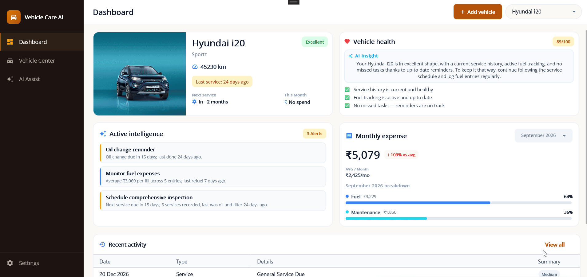

# Smart Vehicle Care



An AI-assisted .NET MAUI vehicle-management sample that combines vehicle records, maintenance schedules, fuel history, dashboard insights, nearby-place discovery, and an Azure OpenAI chat assistant.

## Overview

Users manage vehicles and service/fuel/schedule records. Vehicle context is used by Azure OpenAI to answer maintenance questions and generate dashboard insights. Nearby places are loaded from OpenStreetMap services and fall back through AI or labeled static data.

## AI Capabilities

- Vehicle-specific chat assistance.
- AI dashboard insight and health-summary generation.
- Context from the selected vehicle, odometer, health score, and recent records.
- AI-generated nearby-place fallback.

## Key Features

- Add and manage vehicles.
- Record service history and fuel logs.
- Schedule maintenance.
- View health and expense information.
- Chat with a vehicle-care assistant.
- Discover nearby fuel stations and service centers.
- Use local rule-based data and fallbacks without live AI.

## Application Workflow

1. The splash/Welcome flow opens the main vehicle application.
2. The user adds or selects a vehicle.
3. `VehicleDataService` exposes vehicle, service, fuel, and schedule records.
4. Dashboard and AI pages read the selected vehicle and build context.
5. `AzureOpenAIService` sends requests when endpoint/key/deployment are configured.
6. Nearby-place requests query Overpass/OSM before fallback sources.
7. Results are rendered in dashboards, lists, chat, scheduler, and map.

## AI Workflow

```text
Selected Vehicle and Records
    ↓
ViewModel Prompt Builder
    ↓
AzureOpenAIService
    ↓
Azure OpenAI Chat Completions
    ↓
Vehicle Advice or Dashboard Insight
```

Nearby places follow:

```text
Overpass/OSM
    ↓
Azure OpenAI Generated Places
    ↓
Curated Static Sample Data
```

## AI Architecture

- **Views:** Dashboard, AI assistant, vehicle center, settings, splash, welcome, and add/edit panels.
- **ViewModels:** Dashboard, AI assistant, vehicle center, settings, welcome, and entry ViewModels.
- **Services:** `AzureOpenAIService`, `VehicleDataService`, and `ServiceCenterDataHelper`.
- **Models:** `Vehicle`, `CustomMarker`, dashboard, and vehicle-center data.
- **Persistence:** Vehicle data is serialized into device `Preferences`.

## Syncfusion Controls Used

- `SfAIAssistView`
- `SfScheduler`
- `SfMaps`
- `SfDataGrid`
- `SfCartesianChart`
- `SfTabView`
- `SfPopup`
- `SfDatePicker`
- `SfTimePicker`
- `SfComboBox`
- `SfTextInputLayout`
- `SfLinearProgressBar`
- `SfBusyIndicator`
- `SfButton`

## Prerequisites

- .NET 10 SDK.
- .NET MAUI workload for the target platform (iOS and Mac Catalyst targets are skipped on Linux; the Windows target is built only on Windows).
- Syncfusion packages referenced by `SmartVehicleCare.csproj` (AIAssistView, Core, Inputs, Buttons, Maps, Picker, Charts, Scheduler, TabView, ProgressBar, DataGrid, Popup).
- Location services for nearby-place discovery.
- Azure OpenAI configuration only for live AI features.
- Internet access for the Overpass/OpenStreetMap nearby-place lookup.

## Configuration

### AI Configuration

AI settings are entered in the app Settings page:

| Setting | Storage | Purpose |
| --- | --- | --- |
| API key | `SecureStorage` | Azure OpenAI API key |
| Base endpoint | `Preferences` | Azure AI Foundry `/openai/v1` endpoint (requests go to `{endpoint}/chat/completions`) |
| Deployment name | `Preferences` | Defaults to `gpt-5-mini` |

No credentials are stored in source code.

### Syncfusion License

The license is read from the `SYNCFUSION_LICENSE_KEY` environment variable at startup in `MauiProgram.cs`. Set it before launching the app.

## Getting Started

Run from `Use Case Samples/Smart Vehicle Care`:

```sh
dotnet restore SmartVehicleCare.slnx

dotnet build SmartVehicleCare/SmartVehicleCare.csproj -t:Run -f net10.0-android
dotnet build SmartVehicleCare/SmartVehicleCare.csproj -t:Run -f net10.0-ios
dotnet build SmartVehicleCare/SmartVehicleCare.csproj -t:Run -f net10.0-maccatalyst
dotnet build SmartVehicleCare/SmartVehicleCare.csproj -t:Run -f net10.0-windows10.0.19041.0
```

## Project Structure

```text
Smart Vehicle Care/
├── SmartVehicleCare.slnx
├── vehicle-care-demo.gif
└── SmartVehicleCare/
    ├── Behaviors/
    ├── Converters/
    ├── Helpers/
    ├── Models/
    ├── Platforms/
    ├── Properties/
    ├── Resources/
    ├── Services/
    ├── ViewModels/
    ├── Views/
    ├── App.xaml
    ├── AppShell.xaml
    ├── MauiProgram.cs
    └── SmartVehicleCare.csproj
```

## Troubleshooting

- **AI is unavailable:** Open Settings and enter the key, endpoint, and deployment.
- **Nearby map shows sample data:** Grant location permission and check network access. Static results are labeled as fallback data.
- **Vehicle data missing after reinstall or clearing app data:** Vehicle data is stored as JSON in `Preferences`, which is removed with app data.
- **License watermark:** Set `SYNCFUSION_LICENSE_KEY`.

## Responsible AI Considerations

- AI prompts include vehicle profile and recent record context.
- AI maintenance advice is not authoritative service guidance.
- API keys are not stored in source or committed.
- Review Overpass and Azure requests before adding personal information.

## Related Documentation

- [Syncfusion AIAssistView for .NET MAUI](https://help.syncfusion.com/maui/aiassistview/getting-started)
- [Syncfusion Scheduler for .NET MAUI](https://help.syncfusion.com/maui/scheduler/getting-started)
- [Azure OpenAI Documentation](https://learn.microsoft.com/azure/ai-services/openai/)

## Supported Platforms

- Android
- iOS
- macOS (Mac Catalyst)
- Windows

## Limitations

- Live AI features require Azure configuration.
- Vehicle records are demonstration data stored on-device in `Preferences` (no cloud sync or database).
- Nearby static fallbacks are not live inventory.

## License

Syncfusion controls require a valid Syncfusion license for production use.
