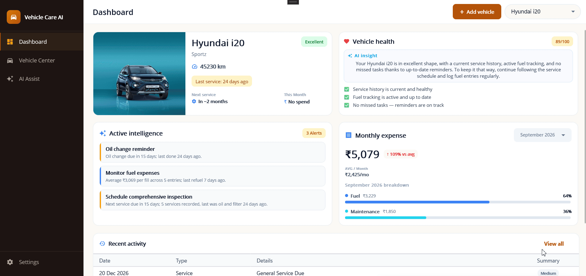

# Smart Vehicle Care: AI-Powered Vehicle Management in .NET MAUI

An AI-powered vehicle care companion sample that demonstrates how a .NET MAUI app can combine Syncfusion UI controls with Azure OpenAI to deliver vehicle health insights, an AI maintenance assistant, real nearby-service discovery, and maintenance scheduling in a single cross-platform app.

## Overview

Vehicle owners struggle to answer simple questions: *Is my car healthy? When is the next service due? Where is the nearest fuel station or service center? What does my fuel spending look like?* This sample builds a complete vehicle-management experience around those questions.

- **What the sample does:** Tracks vehicles, service records, fuel logs, and schedule reminders; scores vehicle health; renders a dashboard; chats with an AI vehicle-care specialist; and shows real nearby fuel stations/service centers on a map.
- **Who it is for:** .NET MAUI developers who want to learn how to embed conversational AI (chat completions), contextual prompt building, and location-based fallbacks into a line-of-business mobile/desktop app.
- **What AI capability it uses:** Azure OpenAI chat completions (non-streaming). The app builds a rich system + user prompt from real vehicle context (odometer, health score, last 5 services, last 5 fuel entries, reminder status) so responses are grounded in actual data.
- **What outcome the user gets:** Practical, vehicle-specific maintenance advice, AI-generated dashboard insights and health summaries, plus graceful degradation: the app remains fully usable offline with rule-based insights when no AI key is configured.

## Key Features

- **Dashboard**: Vehicle health score, service history summary, fuel log, expense chart, recent activities, and quick actions.
- **AI Assistant**: Conversational AI (SfAIAssistView) that answers vehicle maintenance, cost, and service questions using the selected vehicle's real records as prompt context.
- **AI Dashboard Insights**: AI-generated insight cards and a health summary whose tone adapts to the current health score (excellent / watch item / needs attention).
- **Vehicle Center**: Add and manage multiple vehicles with service and fuel records in tabbed SfDataGrid views.
- **Maintenance Scheduler**: SfScheduler with month/week/day views and color-coded appointment types (Service, Inspection, Overdue).
- **Nearby Network**: Live map (SfMaps tile layer) showing fuel stations or service centers within 10 km using the Overpass OpenStreetMap API (multiple server fallbacks), with an AI fallback and a curated static sample dataset if all live sources fail.
- **Welcome Wizard**: Step-by-step first-launch onboarding (vehicle profile) with adaptive layouts: two-column hero layout on Windows/macOS, single-column on Android/iOS.

## AI Flow

1. The user opens the **AI Assist** tab (or the dashboard triggers an insights/health-summary refresh) and types a vehicle-related question or taps a suggestion.
2. The ViewModel gathers context: the selected vehicle's profile, odometer reading, health score, the last 5 service records, last 5 fuel entries, and upcoming/overdue reminders.
3. A system message ("You are a vehicle care specialist…") plus the vehicle-context user prompt are sent to `AzureOpenAIService`, which posts to `{BaseEndpoint}/chat/completions` on the Azure AI Foundry `/openai/v1` endpoint (non-streaming, 30-second HTTP timeout, cancellation-supported).
4. The app receives the JSON response, extracts the assistant message, and returns it to the ViewModel.
5. The response is rendered as an AI bubble in `SfAIAssistView` (or as insight cards / a health summary on the dashboard).
6. Fallback behavior: if no API key/endpoint is configured, requests are rejected with a friendly message pointing to Settings; if the AI call fails or times out, an inline "trouble reaching the AI" message is shown, and the app remains fully usable. Nearby places fall back: Overpass → Azure OpenAI-generated places → curated static sample data (clearly labeled).

## Controls Used

- **SfAIAssistView**: The AI chat interface: message bubbles, suggestions, typing/loading indicator, and request handling.
- **SfScheduler**: Month/Week/Day maintenance scheduling with color-coded appointment types.
- **SfMaps**: Tile-layer map that pins nearby fuel stations and service centers with markers and tooltips.
- **SfDataGrid**: Tabular service history and fuel log per vehicle.
- **SfCartesianChart**: Dashboard expense/fuel-trend column chart with tooltips.
- **SfTabView**: Dashboard and Vehicle Center tab navigation.
- **SfPopup**: Add/edit dialogs for vehicles, services, fuel entries, and schedules.
- **SfDatePicker / SfTimePicker**: Date and time selection inside the add-schedule flow.
- **SfComboBox**: Vehicle type, fuel type, and selection inputs.
- **SfTextInputLayout**: Form fields in the wizard and add/edit panels (with hint labels and numeric behaviors).
- **SfLinearProgressBar**: Inline progress for loading/health indicators.
- **SfBusyIndicator**: Loading state while AI requests and map data are in flight.
- **SfButton**: Actions across the dashboard, wizard, and forms.

## Architecture

The sample follows the MVVM pattern:

- **Views/** (`MainPage`, `AIAssistPage`, `VehicleCenterPage`, `SettingsPage`, `WelcomePage`, `SplashPage`, add/edit panels): XAML UI pages and layouts.
- **ViewModels/** (`MainViewModel`, `AIAssistViewModel`, `VehicleCenterViewModel`, `SettingsViewModel`, `WelcomeViewModel`, add/edit ViewModels): presentation logic; build AI prompts, manage loading state, and synchronize with the data service via events.
- **Services/**
  - `AzureOpenAIService`: chat completions client; also owns AI configuration (API key, endpoint, deployment name).
  - `VehicleDataService`: singleton in-memory data store for vehicles, services, fuel, and reminders; persists to device storage as JSON via `Preferences`.
  - `ServiceCenterDataHelper`: Overpass (OpenStreetMap) queries for nearby fuel stations/service centers, plus a curated static fallback dataset.
- **Models/**: `Vehicle`, `CustomMarker`, dashboard and vehicle-center models.
- **Helpers/**: `ConstellationDrawable`, `VehicleCenterCalculations`.
- **Resources/**: Styles, fonts, images, splash/app icons.

Data flow: Views bind to ViewModels → ViewModels read/write `VehicleDataService` → changes are persisted as JSON → `AzureOpenAIService` and `ServiceCenterDataHelper` consume the data to produce AI or map output → ViewModels render results back into the UI.

## Prerequisites

- .NET 10 SDK (net10.0)
- .NET MAUI workload (`dotnet workload install maui`)
- Visual Studio 2022 (17.12+) with the .NET MAUI workload, or VS Code with the MAUI extension
- Syncfusion .NET MAUI packages (installed via NuGet; a valid Syncfusion license key is required to avoid trial watermarks)
- Azure OpenAI account (optional: AI features are enhancements; the app runs fully offline)
- Android: device/emulator with location services for the Nearby map

## AI Configuration

All AI settings are entered at runtime in the app's **Settings** tab, and nothing is hardcoded in source:

1. **Azure OpenAI API key**: saved via `SecureStorage` and never written to source.
2. **Azure OpenAI endpoint**: the Azure AI Foundry `/openai/v1` project endpoint, e.g. `https://<your-project>.openai.azure.com/openai/v1`; stored via `Preferences` (not a secret).
3. **Deployment name**: defaults to `gpt-5-mini`; stored via `Preferences`.

The Syncfusion license key is read from the `SYNCFUSION_LICENSE_KEY` environment variable at startup:

```bash
# Windows (PowerShell)
$env:SYNCFUSION_LICENSE_KEY = "<your license key>"

# macOS / Linux
export SYNCFUSION_LICENSE_KEY="<your license key>"
```

### Default Behavior

This sample uses **real cloud AI** (Azure OpenAI chat completions) when configured, with layered fallbacks:

- **AI Assistant / Dashboard insights:** real Azure OpenAI when a key + endpoint are set; otherwise a friendly "configure in Settings" message, and rule-based local insights keep the dashboard informative offline.
- **Nearby Network:** live Overpass/OSM data first; if all Overpass servers fail, Azure OpenAI generates plausible nearby places; if AI is also unavailable, a curated static sample dataset is shown (labeled as sample data).

## Environment Variables / Secrets

| Variable | Required | Description |
|---|---|---|
| `SYNCFUSION_LICENSE_KEY` | yes | Syncfusion license key to remove trial watermarks |
| Azure OpenAI API key (in-app Settings) | no | Stored via `SecureStorage`; needed only for AI features |
| Azure OpenAI endpoint (in-app Settings) | no | Azure AI Foundry `/openai/v1` endpoint URL |
| Deployment name (in-app Settings) | no | Model deployment; defaults to `gpt-5-mini` |
| Request timeout | no | Fixed at 30 seconds in `AzureOpenAIService` |

Notes:

- Do not commit keys to source control.
- AI credentials are entered in-app and stored on-device (`SecureStorage`/`Preferences`); nothing is committed to the repository.
- If configuration is missing, AI features show guidance messages and the app continues to work fully offline.

## Run

```bash
dotnet build SmartVehicleCare.slnx -t:Run -f net10.0-android
```

Other platforms (build on the corresponding OS):

```bash
# Windows
dotnet build SmartVehicleCare.slnx -t:Run -f net10.0-windows10.0.19041.0

# iOS (macOS)
dotnet build SmartVehicleCare.slnx -t:Run -f net10.0-ios

# macOS (Mac Catalyst)
dotnet build SmartVehicleCare.slnx -t:Run -f net10.0-maccatalyst
```

Or open `SmartVehicleCare.slnx` in Visual Studio and deploy to your target platform.

## Output



## Project Structure

- **Views/**: UI pages and layouts (dashboard, AI assist, vehicle center, settings, wizard, add/edit panels)
- **ViewModels/**: presentation logic (prompt building, loading states, data synchronization)
- **Models/**: data structures (`Vehicle`, `CustomMarker`, dashboard and vehicle-center models)
- **Services/**: AI and helper services (`AzureOpenAIService`, `VehicleDataService`, `ServiceCenterDataHelper`)
- **Resources/**: styles, images, fonts, and app/splash icons
- **Helpers/**: drawing and calculation utilities
- **Behaviors/ / Converters/**: input validation behaviors and XAML value converters

## Troubleshooting

### Issue 1: Missing AI configuration
**Cause:** No Azure OpenAI API key/endpoint set.
**Fix:** Open the in-app **Settings** tab, paste your key and endpoint, and retry. The app itself runs fully offline without them.

### Issue 2: No AI response
**Cause:** Invalid credentials, wrong endpoint format, network issue, or the deployment name doesn't match your Azure resource.
**Fix:** Verify the endpoint is the Azure AI Foundry `/openai/v1` URL (e.g. `https://<project>.openai.azure.com/openai/v1`), the key is valid, the deployment name exists (default `gpt-5-mini`), and you have network connectivity.

### Issue 3: Nearby map shows sample data
**Cause:** Location permission denied, or all Overpass API servers are temporarily unavailable.
**Fix:** Grant location permission when prompted and ensure location services are on; the app automatically falls back to AI-generated or curated static sample data, which is labeled as such.

### Issue 4: Build or workload errors
**Cause:** Missing .NET 10 SDK, missing MAUI workload, or incompatible package versions.
**Fix:** Install the .NET 10 SDK and run `dotnet workload install maui`; verify Syncfusion package versions restore correctly.

### Issue 5: Path Too Long exception
**Cause:** Deep clone paths on Windows exceed MAX_PATH.
**Fix:** Close Visual Studio, rename the cloned folder to a shorter path, and rebuild.

## Security and Privacy Notes

- Do not hard-code API keys: this sample stores the Azure OpenAI key in `SecureStorage` and reads the Syncfusion license from an environment variable.
- The AI service is sent only vehicle context (make/model, odometer, health score, recent service/fuel/reminders) and the user's question; do not add unnecessary sensitive data to prompts.
- The endpoint and deployment name are non-secrets and stored via `Preferences`; the API key never leaves secure storage in plaintext.
- No credentials are written to source or committed; the only external calls are to your Azure OpenAI endpoint, Overpass/OSM servers, and map tiles.
- Review the Overpass query and AI requests before extending them with personal data (e.g. registration numbers are shown locally but included in the AI prompt context only if you add them).

## Supported Platforms

- Android
- iOS
- Windows
- macOS (Mac Catalyst)

## License

The Smart Vehicle Care sample is provided by Syncfusion for demonstrative purposes. Syncfusion has no liability for any damage or consequence that may arise by the use or viewing of the Smart Vehicle Care sample. The Smart Vehicle Care sample is for demonstrative purposes and if you choose to use or access the sample you agree to not hold Syncfusion liable, in any form, for any damage that is related to use, accessing or otherwise viewing the Smart Vehicle Care sample. By accessing, viewing, or otherwise seeing the Smart Vehicle Care sample you acknowledge and agree Syncfusion's examples will not allow you to seek injunctive relief in any form for any claim related to the sample. If you do not agree to this, do not view, access, utilize or otherwise do anything with Syncfusion's Smart Vehicle Care sample.