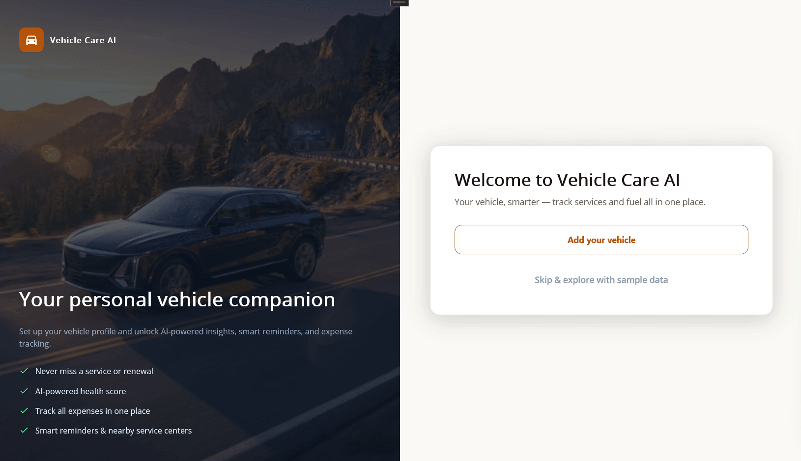

# Build an AI-Powered Vehicle Care App in .NET MAUI with Syncfusion Controls

This repository demonstrates how to build a complete vehicle management app in .NET MAUI by combining Syncfusion's rich UI controls with an Azure OpenAI backend. It covers service tracking, fuel logging, maintenance scheduling, nearby place discovery, and an AI chat assistant — all in a single cross-platform app.

## Key highlights

* Multi-tab dashboard with health scoring and quick-action panels
* AI Assistant powered by Azure OpenAI for vehicle-specific queries
* Real nearby service centers and fuel stations via OpenStreetMap (Overpass API)
* Maintenance scheduler with calendar views and overdue alerts
* Platform-aware UX: two-column layout on Windows/macOS, full-screen on Android/iOS

## Features

* **Dashboard** – Vehicle health score, service history summary, fuel log, and quick actions.
* **AI Assistant** – Conversational AI (SfAIAssistView) answering vehicle maintenance, cost, and service questions.
* **Vehicle Center** – Add and manage multiple vehicles with service and fuel records via SfDataGrid.
* **Maintenance Scheduler** – SfScheduler with Month/Week/Day views, color-coded appointment types (Service, Inspection, Overdue).
* **Nearby Network** – Live map (SfMaps tile layer) showing fuel stations or service centers within 10 km using Overpass OSM data with an AI fallback.
* **Welcome Wizard** – Step-by-step onboarding (vehicle profile) with adaptive layouts.

## Technologies Used

* **.NET MAUI** – Cross-platform framework for Android, iOS, macOS, and Windows.
* **Syncfusion Controls** – SfAIAssistView, SfScheduler, SfMaps, SfDataGrid, SfTabView, SfCharts, SfPopup, SfPicker, SfProgressBar, SfButtons, SfInputs, and more.
* **Azure OpenAI Services** – AI Assistant chat.
* **Overpass API (OpenStreetMap)** – Real-time nearby fuel stations and service centers.

## Prerequisites

* .NET SDK compatible with .NET MAUI (net10.0 or later)
* Visual Studio 2022 with .NET MAUI workload installed
* Syncfusion license key (via the `SYNCFUSION_LICENSE_KEY` environment variable — see below)
* Azure OpenAI account (optional — the key, endpoint, and deployment name are all entered in the in-app Settings tab; the key is stored via `SecureStorage`)

## Quick Install

**Clone:**
```bash
git clone https://github.com/syncfusion/maui-ai-usecase-demos
cd "Use Case Samples/Smart Vehicle Care"
```

**Register the Syncfusion license** — the app reads the license from the `SYNCFUSION_LICENSE_KEY` environment variable (no source edits required). Without a valid license, Syncfusion controls render a watermark or trial dialog:

```bash
# Windows (PowerShell)
$env:SYNCFUSION_LICENSE_KEY = "<your license key>"

# macOS / Linux
export SYNCFUSION_LICENSE_KEY="<your license key>"
```

**Configure Azure OpenAI (optional)** — the app stores credentials on the device; nothing is committed to source:

1. Run the app and open the **Settings** tab.
2. Paste your **Azure OpenAI API key** — it is saved via `SecureStorage` and never written to source code.
3. Enter your **Azure OpenAI endpoint** — the Azure AI Foundry `/openai/v1` project endpoint, e.g. `https://<your-project>.openai.azure.com/openai/v1` (stored via `Preferences`).
4. Set the **deployment name** (default: `gpt-5-mini`) if your deployment differs.

The app runs fully offline — AI features are optional enhancements.

## How It Works

### Navigation Flow

* Shell hosts a tab bar with Dashboard, AI Assist, Vehicle Center, and Settings tabs.
* Welcome wizard runs on first launch; sample data can be loaded via "Skip & Explore".
* On Windows/macOS the wizard shows a hero image panel alongside the form; on mobile only the form is shown (no card elevation).

### Data Persistence

* Vehicle, service, fuel, and schedule data is kept in memory and persisted to device storage (JSON via `Preferences`) on every change.
* On app restart the stored data is restored automatically, and the welcome wizard is skipped when a previous session exists.
* The Azure OpenAI API key lives in `SecureStorage`; the endpoint and deployment name live in `Preferences` (they are not secrets). No credentials are ever written to source or committed.

### AI Assistant

* User types a vehicle-related question in `SfAIAssistView`.
* `AIAssistViewModel` forwards the message to `AzureOpenAIService` with a vehicle-context system prompt.
* The full response is returned and displayed as an AI bubble (non-streaming request/response).
* If no API key is configured, the assistant shows a graceful offline message.

### Nearby Network

* On tab load, GPS coordinates are obtained and an Overpass OSM query runs for fuel stations or service centers within 10 km.
* If Overpass is unavailable, Azure OpenAI generates plausible nearby places as a fallback.
* If both are unavailable, a curated static sample dataset is shown.
* **Note:** when live OSM data is unavailable, the results are AI-generated or curated sample data and may be illustrative rather than real businesses — the map summary is labeled "sample data" in that case.
* Results are pinned on an `SfMaps` tile layer and listed in a card below the map.

## Troubleshooting

### No AI Response
* Verify Azure OpenAI credentials (endpoint, key, deployment name).
* Check network connectivity.
* The app runs fully offline — AI features are optional enhancements.

### Nearby Map Shows Sample Data
* Grant location permission when prompted.
* The Overpass API may be temporarily unavailable; the app automatically falls back to static sample data.

### Path Too Long Exception
* Close Visual Studio, rename the cloned folder to a shorter path, and rebuild.

## Screenshot



## Documentation

* [Syncfusion .NET MAUI AI AssistView](https://help.syncfusion.com/maui/aiassistview/getting-started)
* [Syncfusion .NET MAUI Scheduler](https://help.syncfusion.com/maui/scheduler/getting-started)
* [Syncfusion .NET MAUI Maps](https://help.syncfusion.com/maui/maps/getting-started)
* [Azure OpenAI Service Documentation](https://learn.microsoft.com/en-us/azure/ai-foundry/?view=foundry-classic)
