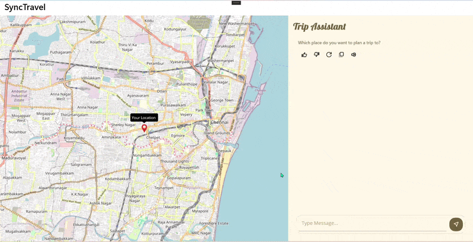

# Travel Planner

A .NET MAUI sample that uses a guided AI conversation to create a trip summary with places, hotels, food spots, ratings, and map locations.

## Overview

Travel planning requires coordinating destination, dates, trip type, and interests. This sample guides travelers through those choices in a conversation and uses Azure OpenAI to generate a destination summary and recommendations. The result is displayed as categorized place lists and on a map. When AI configuration is absent or the response is unusable, the app displays clearly identified local sample itinerary data.

- **What it does:** Collects trip details and presents recommendations for top places, hotels, and food spots.
- **Who it is for:** Users planning a trip and developers evaluating a conversational trip-planning experience in .NET MAUI.
- **AI capability:** Azure OpenAI chat completions, prompted to return structured JSON recommendations.
- **Outcome:** A consolidated trip summary and recommendation lists, with available location pins shown on a map.

## Key Features

- Guided conversation for destination, future travel dates, trip type, and interests.
- Calendar date selection and chip-based trip-type and interest selection.
- Azure OpenAI-generated destination summary and place, hotel, and food recommendations.
- Recommendation cards with ratings and a map; local sample itinerary data keeps the interface demonstrable without a usable AI response.

## AI Flow

1. The user starts the conversation and provides a destination, dates, trip type, and interests.
2. `TravelPlannerViewModel` prepares a `TripInput` from the collected values.
3. `OpenAIServices` sends a chat-completions request to the configured Azure OpenAI deployment, asking for structured itinerary JSON.
4. The service parses the response into a `TripRecommendation` containing the summary and recommendation lists.
5. The ViewModel updates the bound summary and lists; the page renders cards and map locations when coordinates are available.
6. If credentials are missing, the request fails, or a recommendation category is empty, the ViewModel uses local sample itinerary data and labels it as sample data.

## Controls Used

- `SfAIAssistView` - presents the guided conversation, request/response items, suggestions, and custom editor.
- `SfBottomSheet` - hosts the floating conversation surface on phone layouts.
- `SfChip` / `SfChipGroup` - presents trip-type suggestions and multi-select interests.
- `SfCalendar` - selects the trip date range.
- `SfListView` - displays top places, hotels, and food spots.
- `SfRating` - displays recommendation ratings.
- `SfMaps` (`MapTileLayer`) - displays maps and available recommendation location pins using OpenStreetMap tiles.

## Architecture

- **View:** `MainPage.xaml` and `MainPage.xaml.cs` provide the phone and larger-screen layouts, conversation surface, recommendation panels, and map.
- **ViewModel:** `TravelPlannerViewModel` manages conversation state, user input, AI requests, local fallback data, and bound recommendation state.
- **AI service:** `OpenAIServices` calls Azure OpenAI and parses recommendation responses.
- **Models:** `TripInput`, `PlaceCard`, and `TripRecommendation` represent trip input and results; `MapMarkerLabel` supports map marker labels.
- **Supporting UI and services:** XAML converters, `DotAnimationBehavior`, and platform keyboard services support presentation and input behavior.
- **Startup:** `MauiProgram` registers the service, ViewModel, and page and configures Syncfusion controls; `App` registers the Syncfusion license.

## Prerequisites

- .NET 10 SDK (the existing sample README specifies 10.0.401 or newer preview).
- MAUI workload for the target platform. The original sample setup specifies `dotnet workload install maui-android maui-ios maui-maccatalyst`. The project targets Android, iOS, and Mac Catalyst; Windows is added when building on Windows.
- Visual Studio is not specified as a requirement by the project.
- Syncfusion MAUI packages are referenced in `TravelPlanner.csproj`; a Syncfusion license key is read from `SYNCFUSION_LICENSE_KEY`.
- An Azure OpenAI resource and chat deployment are needed for live AI recommendations. Without usable endpoint and key configuration, local sample data is used.

## AI Configuration

`OpenAIServices` reads its Azure OpenAI settings from environment variables at application startup:

| Environment variable | Requirement | Default / purpose |
| --- | --- | --- |
| `AZURE_OPENAI_ENDPOINT` | Required for live AI | Azure OpenAI resource endpoint; trailing slash is trimmed. |
| `AZURE_OPENAI_KEY` | Required for live AI | Azure OpenAI API key. |
| `AZURE_OPENAI_CHAT_DEPLOYMENT` | Optional | Defaults to `gpt-4o-mini`. |
| `AZURE_OPENAI_API_VERSION` | Optional | Defaults to `2024-08-01-preview`. |

The application sends the destination, dates, trip type, and selected interests to the configured service. The prompt requests a summary and structured lists of places, hotels, and food spots. Place images use the local `image_not_available.png` asset; the sample does not fetch images from third-party services.

## Default Behavior

The sample uses a real Azure OpenAI service when the endpoint and key are configured. Otherwise, or when the request fails or any recommendation category is empty, it creates a local sample itinerary. Sample data is labeled in the conversation and is not represented as AI-generated or verified destination information. There is no separate offline AI model.

## Environment Variables / Secrets

- `AZURE_OPENAI_ENDPOINT`
- `AZURE_OPENAI_KEY`
- `AZURE_OPENAI_CHAT_DEPLOYMENT` (optional; defaults to `gpt-4o-mini`)
- `AZURE_OPENAI_API_VERSION` (optional; defaults to `2024-08-01-preview`)
- `SYNCFUSION_LICENSE_KEY` (Syncfusion license registration)

### Notes

- Do not commit API keys or Syncfusion license keys to source control.
- Supply credentials through environment variables or an appropriate secrets store.
- If Azure OpenAI endpoint or key configuration is missing or contains placeholder values, the app uses local sample itinerary data. AI request failures or incomplete recommendation categories also cause local sample data to be used.

## Run

Restore and run from the `Use Case Samples/Travel Planner` directory:

```sh
dotnet restore TravelPlanner.slnx

# Android
dotnet build TravelPlanner/TravelPlanner.csproj -t:Run -f net10.0-android

# iOS
dotnet build TravelPlanner/TravelPlanner.csproj -t:Run -f net10.0-ios

# Mac Catalyst
dotnet build TravelPlanner/TravelPlanner.csproj -t:Run -f net10.0-maccatalyst

# Windows (from a Windows host)
dotnet build TravelPlanner/TravelPlanner.csproj -t:Run -f net10.0-windows10.0.19041.0
```

Start the trip conversation and follow its prompts. Once recommendations are generated, open the trip details drawer to review the summary, lists, and map.

## Output

The UI presents a guided trip-planning conversation alongside a map and a consolidated trip-details view. The details include a destination summary, top-place, hotel, and food-spot lists with ratings, and available location pins.



## Project Structure

- `TravelPlanner/` - MAUI application project.
- `TravelPlanner/MainPage.xaml` and `MainPage.xaml.cs` - page layout and view behavior.
- `TravelPlanner/ViewModels/` - conversation and presentation logic.
- `TravelPlanner/Models/` - trip input, recommendation, and map marker data structures.
- `TravelPlanner/Services/` - Azure OpenAI and platform keyboard services.
- `TravelPlanner/Converters/` - XAML value converters.
- `TravelPlanner/Resources/` - styles, images, fonts, app icon, and other assets.
- `TravelPlanner/Platforms/` - platform-specific application and keyboard service files.

## Troubleshooting

**Issue: Azure OpenAI recommendations are not being generated**
**Cause:** Endpoint/key configuration is missing, contains placeholder values, or the Azure OpenAI request failed.
**Fix:** Check `AZURE_OPENAI_ENDPOINT`, `AZURE_OPENAI_KEY`, and the optional deployment and API version settings. The app uses local sample itinerary data when live recommendations cannot be used.

**Issue: Build or workload errors**
**Cause:** The required .NET SDK or platform MAUI workload is unavailable, or the target platform is not supported by the current host.
**Fix:** Use the .NET 10 SDK, install the MAUI workload required for the target, and build Windows targets from a Windows host.

**Issue: Recommendations contain sample data or are incomplete**
**Cause:** Azure OpenAI is unavailable or returned incomplete recommendation categories.
**Fix:** Review the trip inputs and Azure OpenAI settings. The sample deliberately falls back to local sample data in this case.

## Security and Privacy Notes

- Do not hard-code or commit API keys or license keys.
- Destination, dates, trip type, and interests are sent to Azure OpenAI when live AI is configured; avoid entering sensitive information.
- The request contains the trip details used to generate recommendations.
- Use an appropriate secure mechanism to provide credentials.
- Map tiles are loaded from OpenStreetMap tile servers. Place images are local placeholders; the sample does not fetch recommendation images from third-party services.

## Supported Platforms

- Android
- iOS
- Mac Catalyst
- Windows (target configured on Windows)
