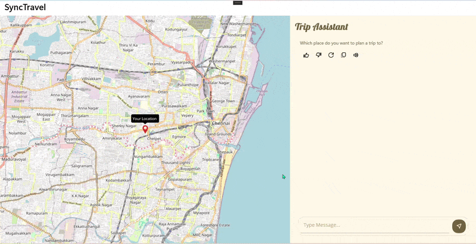

# Travel Planner



A .NET MAUI travel-planning sample that collects trip details in a conversational interface, requests structured Azure OpenAI recommendations, and displays cards and map pins.

## Overview

The app gathers destination, dates, trip type, and interests, then produces a destination summary and lists of places, hotels, and food spots.

## AI Capabilities

### Structured Trip Recommendations
- After the guided chat finishes, `OpenAIServices.GetTripRecommendationsAsync` makes one Azure OpenAI chat request. The prompt contains the destination, the start and end dates, the trip type (Couple, Solo, Friends or Family) and the selected interests.
- The system prompt asks for strict JSON only: a `destinationSummary` plus `topPlaces`, `hotels` and `foodSpots`. Each list should have exactly 5 items with `name`, `address` and `rating`, and the top places also carry a `location` with latitude and longitude.
- The result is parsed into `TripRecommendation` and shown as the destination summary and three card lists in the Trip Summary drawer. Because the prompt includes the interests and trip type, the suggestions are tailored to the trip and are not a fixed list.

### Response Parsing and Cleanup
- If the model wraps the JSON in a code fence, the app cuts out the part between the first `{` and the last `}` before parsing.
- The parser accepts several property names for the same value, such as `name`, `title`, `hotelName` or `restaurantName`, and `rating`, `score` or `stars`. This keeps cards filled when the model changes the field names slightly.
- Coordinates are read from a `{latitude, longitude}` object, a two-number array, a "lat, lon" string, or a `coordinates` array. For the array and string forms, a first value between -90 and 90 is treated as the latitude.
- A card with a missing name, address or rating gets a default ("Attraction", "Hotel" or "Food Spot", "Address not available", and a rating of 4.2) so each card always shows text. Every card uses the bundled `image_not_available.png` image because the AI does not return pictures.

### Map Pins from AI Data
- The AI coordinates for the top places become the pins on the Trip Summary map, and the map is fitted to those pins.
- If a place has no coordinates, the app geocodes its address with the device `Geocoding` service. A place that cannot be located is left off the map.
- Tapping a place card drops a pin for that place on the main map and zooms to it, using the same coordinates or address lookup.

### Sample Itinerary Fallback
- If the Azure OpenAI variables are missing, the request fails, or any of the three lists comes back empty, the app uses a built-in sample itinerary. It has 5 sample attractions, 4 sample hotels and 5 sample food spots, and its summary names the destination, trip type and interests.
- When sample data is used, the chat says "Sample itinerary ready. Some or all details are demo data…" and adds "Showing sample trip details; these suggestions are not AI-generated or verified for this destination." so the user is never misled.

## Key Features

### Guided Conversation Planning
The `SfAIAssistView` chat asks one question at a time and moves through the steps Destination, Dates, Trip type, Interests and Building. The app, not the AI, drives these questions.
- The assistant starts with "Which place do you want to plan a trip to?" and the user types a destination.
- Trip type is chosen from the suggestion chips Couple, Solo, Friends and Family, which are shown as `SfChip` items.
- After the first typed message (the destination), the text box is disabled. The rest of the flow uses the calendar dialog, the suggestion chips and the interests dialog.
- When the user confirms the interests, the app builds the trip. After the plan is built, the chat is locked, and a restart button appears so the user can plan a new trip.
- A custom response loader with animated dots (`DotAnimationBehavior`) shows while the app waits, and a "Building your trip..." overlay with a spinner is shown while the plan is generated.

### Date Range and Interest Pickers
- A dialog with an `SfCalendar` in Range selection mode opens at the Dates step. Past dates are disabled. The OK button only commits a range that starts after today and ends after the start date, and Cancel clears the selection.
- A second dialog shows 13 interests as `SfChipGroup` filter chips: Food, Hidden Places, Adventure, Shopping, Culture, Beaches, Mountains, Nightlife, History, Relaxation, Art, Nature and Photography. The user can pick several.
- The interests dialog opens by itself after the trip type is chosen, and the "Select Interests" suggestion in the chat opens it again. Confirm with nothing selected shows the message "Please select at least one interest."

### Map and Location
- An `SfMaps` `MapTileLayer` with OpenStreetMap tiles is the main background of the app.
- When the user enters a destination, the app geocodes it, drops a pin with a name tooltip and centers the map on it.
- If location permission is granted, the app also shows a "Your Location" pin and centers on the device position. The Trip Summary drawer has its own `SfMaps` that shows the pins for the top places.

### Trip Summary Drawer
- When the plan is ready, a right-hand drawer slides in and shows the destination name, the summary map and the AI summary text. A flight icon button reopens it and an arrow button closes it.
- Top Places, Hotels and Food Spots are shown in separate `SfListView` lists. Each card shows an image, the name, the address and a read-only `SfRating` star rating.
- The Restart button clears the chat, the lists, the pins and the calendar and chip selections.

### Adaptive Layout
- The page uses `OnIdiom`. On phones the map fills the screen, a floating "Build trip with AI ✨" button opens the chat in an `SfBottomSheet`, and the drawer covers the full width.
- On desktop, the map takes the left side and the Trip Assistant chat is a permanent 600-wide panel on the right, with the summary drawer sliding over that panel.
- On Android and iOS, the bottom sheet expands to full height when the keyboard opens so the message box stays visible.

## Application Workflow

1. The user enters destination, dates, trip type, and interests.
2. `TravelPlannerViewModel` creates `TripInput`.
3. `OpenAIServices` builds and sends the Azure OpenAI chat request.
4. The response is parsed into `TripRecommendation`.
5. Cards and map pins are updated.
6. Missing or failed AI data is replaced with labeled local sample data.

## AI Workflow

```text
Trip Details
    ↓
TravelPlannerViewModel
    ↓
OpenAIServices
    ↓
Azure OpenAI Chat Completions
    ↓
TripRecommendation
    ↓
Cards and Map
```

## AI Architecture

- **View:** `MainPage.xaml` and `MainPage.xaml.cs`.
- **ViewModel:** `TravelPlannerViewModel`.
- **AI service:** `OpenAIServices`.
- **Models:** `TripInput`, `PlaceCard`, and `TripRecommendation` (in `Models/TripItem.cs`), and `MapMarkerLabel`.
- **UI support:** XAML converters and `DotAnimationBehavior`.

## Syncfusion Controls Used

- `SfAIAssistView` (`Syncfusion.Maui.AIAssistView`)
- `SfBottomSheet` (`Syncfusion.Maui.Toolkit`)
- `SfChip`/`SfChipGroup` (`Syncfusion.Maui.Toolkit`)
- `SfCalendar` (`Syncfusion.Maui.Calendar`)
- `SfListView` (`Syncfusion.Maui.ListView`)
- `SfRating` (`Syncfusion.Maui.Inputs`)
- `SfMaps` with `MapTileLayer` (`Syncfusion.Maui.Maps`)

## Prerequisites

- .NET 10 SDK.
- .NET MAUI workloads for target platforms (the Windows target is built only on Windows).
- Syncfusion MAUI packages referenced by `TravelPlanner.csproj` (Core, AIAssistView, Toolkit, ListView, Inputs, Calendar, Maps).
- Azure OpenAI endpoint, key, and deployment for live recommendations.

## Configuration

### AI Configuration

`OpenAIServices` reads:

| Variable | Required | Default |
| --- | --- | --- |
| `AZURE_OPENAI_ENDPOINT` | Live AI | None |
| `AZURE_OPENAI_KEY` | Live AI | None |
| `AZURE_OPENAI_CHAT_DEPLOYMENT` | No | `gpt-4o-mini` |
| `AZURE_OPENAI_API_VERSION` | No | `2024-08-01-preview` |
| `SYNCFUSION_LICENSE_KEY` | Licensing | Falls back to the placeholder `ENTER_YOUR_LICENSE_KEY` in `App.xaml.cs` |

Requests are sent to `{AZURE_OPENAI_ENDPOINT}/openai/deployments/{deployment}/chat/completions`. Set the variables in the environment that launches the app (for example, before starting the IDE) so they are visible to the process. Without an endpoint and key, the app shows a labeled sample itinerary.

## Getting Started

Run from `Use Case Samples/Travel Planner`:

```sh
dotnet restore TravelPlanner.slnx

dotnet build TravelPlanner/TravelPlanner.csproj -t:Run -f net10.0-android
dotnet build TravelPlanner/TravelPlanner.csproj -t:Run -f net10.0-ios
dotnet build TravelPlanner/TravelPlanner.csproj -t:Run -f net10.0-maccatalyst
dotnet build TravelPlanner/TravelPlanner.csproj -t:Run -f net10.0-windows10.0.19041.0
```

## Project Structure

```text
Travel Planner/
├── TravelPlanner.slnx
└── TravelPlanner/
    ├── Converters/
    ├── Models/
    ├── Platforms/
    ├── Properties/
    ├── Resources/
    ├── Services/
    ├── ViewModels/
    ├── App.xaml
    ├── AppShell.xaml
    ├── DotAnimationBehavior.cs
    ├── MainPage.xaml
    ├── MauiProgram.cs
    └── TravelPlanner.csproj
```

## Troubleshooting

- **No live recommendations:** Verify Azure endpoint/key/deployment variables.
- **Empty category:** The app replaces incomplete itinerary data with local sample data.
- **Build target unavailable:** iOS/Mac Catalyst require the appropriate macOS environment.
- **License watermark:** Set a valid `SYNCFUSION_LICENSE_KEY`.

## Responsible AI Considerations

- Recommendation addresses, ratings, and availability may be inaccurate.
- Verify official destination, travel, and booking requirements.
- Destination data is sent to Azure OpenAI in live mode.
- Avoid sensitive personal information in prompts.

## Related Documentation

- [Syncfusion AIAssistView for .NET MAUI](https://help.syncfusion.com/maui/aiassistview/getting-started)
- [Syncfusion Maps for .NET MAUI](https://help.syncfusion.com/maui/maps/getting-started)
- [Azure OpenAI Documentation](https://learn.microsoft.com/azure/ai-services/openai/)

## Supported Platforms

- Android
- iOS
- macOS (Mac Catalyst)
- Windows

## Limitations

- Local fallback data is demonstration data, not live destination data.
- Map tiles use OpenStreetMap tile servers.
- Real-time availability is not queried.

## License

Syncfusion controls require a valid Syncfusion license for production use.
