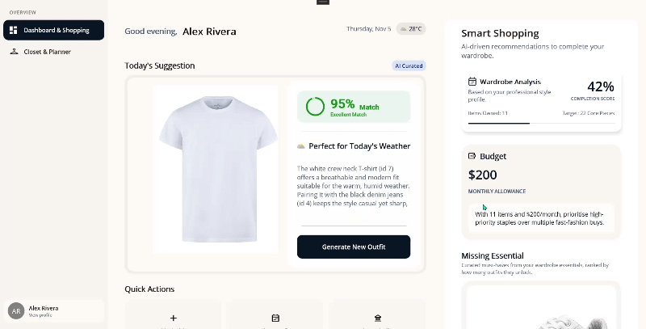

# WardrobeAI

An AI-assisted .NET MAUI wardrobe app that plans outfits and recommends missing wardrobe essentials using Azure OpenAI when configured.

## Overview

WardrobeAI helps users organize clothing and choose outfits for an occasion and date, taking weather and style preferences into account. It also compares the wardrobe with an essentials catalog to suggest items to shop for. Azure OpenAI can generate outfit and shopping recommendations; deterministic local logic provides fallback recommendations when Azure is not configured or a request cannot be completed.

- **What it does:** Catalogs clothing, plans outfits, shows weather-aware outfit recommendations, and identifies wardrobe essentials to shop for.
- **Who it is for:** People organizing a wardrobe and planning outfits, and developers exploring an AI-assisted wardrobe app built with .NET MAUI.
- **AI capability:** Azure OpenAI structured-output outfit recommendations and smart shopping recommendations.
- **Outcome:** A planned outfit with match details and alternatives, plus a list of missing essentials and related budget information.

## Key Features

- Dashboard, Closet, Plan, Shop, and Profile areas.
- Clothing catalog with category filters, clothing attributes, and camera/gallery image selection.
- Occasion- and date-based outfit planning with weather context, match scores, alternatives, and explanations.
- Essentials shopping recommendations, completion score, budget information, and retailer deep links.

## AI Flow

1. The user requests an outfit recommendation or opens the shopping recommendations.
2. The app prepares context from the user's clothing, occasion/date, preferences, and related local wardrobe data.
3. The Azure OpenAI recommendation service processes the request when valid Azure configuration is available.
4. The app interprets structured recommendation data; outfit scoring and shopping logic also use local wardrobe data.
5. ViewModels expose recommendation and scoring data to the relevant pages for display.
6. When Azure is not configured or cannot provide a usable result, the services use deterministic local fallback recommendations.

## Controls Used

- `SfTabView` — provides the main mobile tab navigation.
- `SfChipGroup` — selects clothing filters, clothing attributes, occasions, and style preferences.
- `SfComboBox` — selects clothing attributes in the Add Clothing popup.
- `SfDatePicker` — selects the date for outfit planning.
- `SfRadialGauge` — visualizes outfit match and planner scores.
- `SfRotator` — presents outfit and shopping product cards.
- `SfPopup` — presents Add Clothing, Plan an Outfit, and Add Style dialogs.
- `SfAccordion` — expands the shopping recommendation methodology.
- `SfAvatarView` — displays user/avatar visuals on the dashboard, side rail, and profile.

## Architecture

- **Views:** Dashboard, Closet, Outfit Planner, Shopping, Profile, and host pages in `WardrobeAI/Views/`.
- **ViewModels:** MVVM presentation and command logic in `WardrobeAI/ViewModels/`.
- **AI services:** Azure OpenAI outfit and smart shopping implementations, options, and prompt builders in `WardrobeAI/AI/`.
- **Models and contracts:** User, clothing, outfit, shopping, and weather data structures in `WardrobeAI/Models/` and `WardrobeAI/Contracts/`.
- **Persistence:** EF Core SQLite context in `Data/` and data access in `Repositories/`.
- **Supporting services:** Weather, user context, wardrobe analysis, budget, deep-link, and navigation services in `Services/`.
- **Startup:** `MauiProgram.cs` configures DI, SQLite, Syncfusion, and services; the application stores its database at `FileSystem.AppDataDirectory/wardrobe.db`.

## Prerequisites

- .NET 10 SDK.
- .NET MAUI workload for the target platform. The project README specifies `dotnet workload install maui` and `dotnet workload restore`.
- Visual Studio version is not specified in the project.
- Syncfusion MAUI packages are referenced in `WardrobeAI.csproj` (version 34.2.5). `SYNCFUSION_LICENSE_KEY` is optional for trial use; without a key, Syncfusion controls may show a trial watermark.
- An Azure OpenAI resource is optional. Live recommendations require a valid endpoint, API key, deployment, and API version.

## AI Configuration

`AzureOpenAiOptions` obtains `Endpoint` and `ApiKey` from `AZURE_API_BASE` and `AZURE_API_KEY`. Deployment defaults to `gpt-4.1-mini`; the API version default in source is the placeholder `API_VERSION`. `MauiProgram.cs` registers the options defaults and does not bind them to a configuration file. To use live Azure recommendations, configure the options for local testing or add a secure configuration source in startup. The AI services use local fallback behavior when configuration is incomplete.

Weather and geolocation are provided through Open-Meteo and do not require an API key.

## Default Behavior

- **Real cloud AI:** Azure OpenAI outfit and shopping recommendations are used when configured.
- **Local logic:** Outfit scoring, local wardrobe data, SQLite persistence, weather display, and curated wardrobe-essentials comparison are part of the app.
- **Fallback:** Deterministic outfit recommendations and deterministic randomized smart-shopping picks are used when Azure OpenAI is not configured or the cloud request cannot supply recommendations.
- **Mock AI:** No separate mock AI service is configured; the fallback is local recommendation logic.

## Environment Variables / Secrets

| Variable | Purpose |
| --- | --- |
| `AZURE_API_BASE` | Azure OpenAI endpoint (read by `AzureOpenAiOptions`). |
| `AZURE_API_KEY` | Azure OpenAI API key (read by `AzureOpenAiOptions`). |
| `SYNCFUSION_LICENSE_KEY` | Optional Syncfusion license registration. |

The project does not currently read the deployment or API version from environment variables; those values are defined by `AzureOpenAiOptions` defaults.

### Notes

- Do not commit API keys or Syncfusion license keys to source control.
- Use an appropriate secure configuration source for credentials. The current project reads the endpoint and key environment variables at startup; user secrets or secure storage are not wired up by default.
- If endpoint, key, or deployment configuration is not usable, the AI services fall back to local recommendation behavior.

## Run

Run from the `Use Case Samples/WardrobeAI` directory. Restore workloads and packages first:

```sh
dotnet workload restore
dotnet restore WardrobeAI/WardrobeAI.csproj
```

Use a platform supported by the host and installed workloads. iOS and Mac Catalyst require macOS.

```sh
# Android
dotnet build WardrobeAI/WardrobeAI.csproj -f net10.0-android
dotnet run --project WardrobeAI/WardrobeAI.csproj -f net10.0-android

# iOS (macOS host)
dotnet build WardrobeAI/WardrobeAI.csproj -f net10.0-ios
dotnet run --project WardrobeAI/WardrobeAI.csproj -f net10.0-ios

# Mac Catalyst (macOS host)
dotnet build WardrobeAI/WardrobeAI.csproj -f net10.0-maccatalyst
dotnet run --project WardrobeAI/WardrobeAI.csproj -f net10.0-maccatalyst

# Windows
dotnet build WardrobeAI/WardrobeAI.csproj -f net10.0-windows10.0.19041.0
dotnet run --project WardrobeAI/WardrobeAI.csproj -f net10.0-windows10.0.19041.0
```

## Output

The UI includes a dashboard with a daily outfit and weather, a closet gallery, an outfit planner with recommendation scores and alternatives, and a shopping view with wardrobe essentials.



## Project Structure

- `WardrobeAI/Views/` — Dashboard, Closet, Outfit Planner, Shopping, Profile, and host UI pages.
- `WardrobeAI/ViewModels/` — presentation logic for pages and hosts.
- `WardrobeAI/Models/` and `WardrobeAI/Contracts/` — data structures.
- `WardrobeAI/AI/` — Azure OpenAI services, options, prompts, and recommendation logic.
- `WardrobeAI/Services/` — weather, user, wardrobe, budget, navigation, and related services.
- `WardrobeAI/Data/` and `WardrobeAI/Repositories/` — SQLite/EF Core persistence.
- `WardrobeAI/Resources/` — images, fonts, styles, and bundled assets.
- `WardrobeAI/Platforms/` — platform-specific implementation.

## Troubleshooting

**Issue: Azure OpenAI recommendations use local fallback results**
**Cause:** Endpoint, key, or deployment configuration is missing or invalid, or the cloud request could not provide recommendations.
**Fix:** Verify `AZURE_API_BASE` and `AZURE_API_KEY`, confirm the deployment and API version configured in `AzureOpenAiOptions`, and restart the app.

**Issue: Build or workload errors**
**Cause:** .NET 10 SDK or the required MAUI target workload is missing, or the target is unavailable on the current host.
**Fix:** Verify the .NET 10 SDK and install/restore the required MAUI workload for the platform; build iOS and Mac Catalyst on macOS.

**Issue: Syncfusion controls show a trial watermark**
**Cause:** A valid Syncfusion license key has not been registered.
**Fix:** Set `SYNCFUSION_LICENSE_KEY` before launching and verify that the key matches the installed Syncfusion packages.

**Issue: Weather or location is unavailable**
**Cause:** Network access, platform permission, or device location availability may be missing.
**Fix:** Check connectivity, grant location permission, and verify the device or emulator provides location data.

## Security and Privacy Notes

- Do not hard-code API keys or commit secrets.
- Outfit recommendation requests use wardrobe and planning context; avoid adding unnecessary sensitive information.
- Keep prompts limited to the information required for recommendations.
- Use a secure configuration source for credentials; the current sample reads Azure credentials from environment variables.
- The app calls Azure OpenAI and Open-Meteo; review the data sent to those external services for your deployment and use case.

## Supported Platforms

- Android
- iOS
- Windows (when building on Windows)
- Mac Catalyst (when building on macOS)

## License

Syncfusion controls are subject to the Syncfusion license. A free community license may be available to qualifying users. No separate project license is specified in the sample directory.
