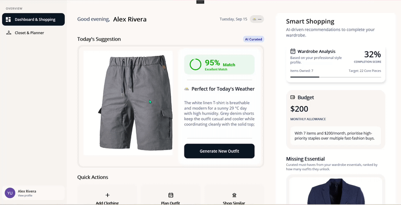

# WardrobeAI



An AI-assisted .NET MAUI wardrobe application that manages clothing, plans outfits, checks weather, compares the closet with a wardrobe essentials catalog, and provides smart shopping recommendations.

## Overview

The app uses EF Core SQLite for wardrobe data and supports Dashboard, Closet, Outfit Planner, Shopping, and Profile areas. Azure OpenAI outfit and shopping services provide live recommendations when configured; local deterministic logic remains available without usable Azure configuration.

## AI Capabilities

### Today's Outfit Suggestion
- The Dashboard asks Azure OpenAI for one outfit from the user's own closet. The prompt contains today's occasion, the current weather (temperature, condition and humidity), gender, age group, style preference, budget level and the closet items.
- The occasion is taken from the plan saved for today. If there is no plan for today, it uses "Casual".
- Each closet item is sent as a short record: id, name, category, color, pattern, fabric, season, style, occasion, favorite flag and usage count. Photos, the user's name, the email and the location are not sent.
- The system prompt tells the model to use only closet ids, to leave a slot empty instead of inventing an item, and to prefer outerwear when the weather is rainy, snowy or 15 °C or colder. The user sees the outfit title, the picked items and a short reason.
- If Azure OpenAI is not configured, the card shows "AI suggestions aren't configured yet…". If a call fails, the Dashboard keeps the last good outfit.

### Structured Output and Validation
- Every outfit and shopping request uses JSON-schema structured output through the `Azure.AI.OpenAI` SDK, so the reply has a fixed shape. For outfits it is a title, occasion, reason, match score and a list of items with an `itemId` and a role (Top, Bottom, Footwear, Outerwear, Accessory or Dress).
- The app checks every returned `itemId` against the closet that was sent and drops any id that is not there. Items are shown in a fixed order: Top, Dress, Bottom, Outerwear, Footwear, Accessory.
- The match score is not taken from the model. `OutfitScorer` calculates it in code as 25% color harmony, 25% style match, 30% occasion match and 20% weather match, so the same closet and weather always give the same score.

### Outfit Planner: One Plan per Occasion
- The Plan tab sends one request for four occasions: Work, Meeting, Casual and Party. The model returns a main outfit, up to 2 alternative looks and a short "why this works" text for each occasion, and the first plan is cached for the four tabs. Tapping an occasion chip later requests a fresh plan.
- The prompt gives style rules per occasion. Work and Meeting favor solid, dark colors and classic tailoring. Casual allows bolder colors, knits, denim and sneakers. Party allows richer textures and statement pieces.
- For each look, the app calculates Match, Style, Comfort and Trend scores itself. Comfort rewards breathable fabrics and Trend rewards classic cuts. The planner shows these as gauges.
- If the AI is not configured, the call fails, the reply cannot be parsed, or an occasion is missing from the reply, the planner builds a look locally. It scores combinations of up to 20 tops, bottoms, dresses and footwear items for that occasion and keeps the best 3. Footwear is found by words in the item name (shoe, sneaker, boot, loafer, heel, sandal). If the closet lacks the pieces, the planner shows a message asking for a top, a bottom and footwear.

### Smart Shopping: Missing Essentials
- The Shop tab sends the closet, the style preference, the budget level, the monthly budget and the 21-item essentials catalog from `wardrobe.json`. The prompt also lists the item count and one anchor item for each category.
- The model must choose items only from the catalog, vary the picks across categories and return them in random order, and give each pick a priority (HIGH, MEDIUM or LOW), a one-sentence reason that names an item the user owns, and 1 to 3 owned items it pairs with. It can return up to 12 picks, and the app shows 6.
- The app keeps only picks whose name matches the catalog, removes duplicates and removes items the user already owns. Each card shows the item, its category, the reason and "Pairs with N existing outfits".
- If the AI is not configured, fails or returns no usable picks, the app picks locally. It skips owned items, ranks the rest by how many owned pieces they pair with and by how foundational the missing category is, then shuffles items with equal rank. It keeps one pick per category, except T-Shirts and Shirts. If that also gives nothing, the cards come from the catalog diff in `WardrobeEssentialsCatalog`.
- The picks are refreshed only when the closet or the monthly budget changes, not on every visit to the tab.

## Key Features

### Dashboard
- The header shows a greeting that changes with the time of day, today's date, and a weather chip with the current temperature and icon. Weather comes from the Open-Meteo API using the device location.
- The Today's Suggestion card shows the picked items in an auto-playing `SfRotator` with dot navigation, plus the title, the reason and a match percentage (with an `SfRadialGauge` ring on desktop and tablet). "Generate New" requests another outfit, and a busy indicator with "Curating your look…" shows while it runs.
- Quick Actions open the Closet (Add Clothing), the Plan tab (Plan Outfit) or the Shop tab (Shop Similar).
- The Upcoming Plans list shows the plans saved from the planner, from today onward, with a date badge and an occasion icon. A Wardrobe Insight card shows a short sentence built from the current outfit's title, occasion and item names.

### Closet
- The Closet lists clothing as cards with the photo, name, category and color, drawn from the SQLite database.
- A search box and an `SfChipGroup` of single-select filter chips narrow the list. The chips are "All" plus the categories that exist in the closet.
- The add button opens an `SfPopup` form with "From Gallery" and "Use Camera" photo buttons and seven `SfComboBox` fields: Category, Occasion, Style, Color, Material, Season and Pattern. Name, Category and Color are required, and the item appears at the top of the list after saving.
- Photos are stored in the local database as base64 text and are not sent to Azure OpenAI.

### Outfit Planner
- Occasion chips (Work, Meeting, Casual, Party) switch the displayed look. Tapping another chip asks for a new plan, and a "Curating outfit" indicator shows while it loads.
- A weather card shows the temperature, a condition label (for example "Sunny & Clear") and a short tip such as "Layer up with outerwear".
- The main look is shown in an `SfRotator` with an "AI GENERATED" badge. Four `SfRadialGauge` rings show Match, Style, Comfort and Trend, followed by "Alternative Looks" cards and a "Why this works" text.
- The floating button opens the "Plan an outfit" popup, where the user enters a plan name, picks a date with `SfDatePicker` (or "Today") and picks one of the occasions Work, Meeting, Casual, Party, Formal, Travel, Sport or Date. The plan is saved to the database and appears on the Dashboard.

### Shopping
- The Wardrobe Analysis card shows a completion score as a percentage with a progress bar, "Items Owned" and a "Target" line that counts the core categories. The score is calculated in code from how many core categories the closet covers.
- The Budget card shows the monthly allowance and a short advice line based on the closet size.
- Missing Essential cards show a product image, the name, a display price, the "pairs with" count and the reason. "Shop Now" opens the Amazon search link stored for that item in `wardrobe.json`. The price is an estimate the app calculates from the item's category and is not a live store price.
- An `SfAccordion` item, "How we picked these", explains the method in plain words.

### Profile
- The Profile tab shows the user's avatar in an `SfAvatarView` (photo or initials) and a style badge made from the first style and the budget level (for example "Smart Saver").
- Style preferences are shown as input chips in an `SfChipGroup`. Tapping the X on a chip removes the style. The add button opens a popup where the user picks a preset style or types their own, with checks for duplicates and length.
- A slider sets the monthly budget from $0 to $1,000 in steps of $25, with a Save button. The value is stored in `Preferences` and used by the Shop tab.

### Adaptive Layout and Storage
- The five tabs (Dashboard, Closet, Plan, Shop, Profile) are shown with an `SfTabView` on phones and tablets.
- On desktop, a side rail opens two split views: "Dashboard & Shopping" and "Closet & Planner". A profile popup (`SfPopup` with an `SfBadgeView` avatar) shows the outfit count, item count, color palette and style preferences.
- The app seeds a default user named "Alex Rivera" and keeps all wardrobe data in a local SQLite database through EF Core. The database is created on first launch.
- Layout sizes change by device type (Phone, Tablet, Desktop) through `OnIdiom` in the pages.

## Application Workflow

1. `UserContext` resolves the seeded default user.
2. Repository services load clothing, planned outfits, and shopping data from SQLite.
3. The Closet page adds or updates clothing records.
4. The Outfit Planner builds occasion/date preferences and wardrobe context.
5. `IAIOutfitRecommendationService` requests Azure OpenAI or uses local outfit logic.
6. The Shopping page compares the closet with the essentials catalog.
7. `IAISmartShoppingService` requests AI shopping recommendations or deterministic fallback picks.

## AI Workflow

```text
Wardrobe, Occasion, Date, and Preferences
    ↓
Outfit or Shopping Service
    ↓
Azure OpenAI (when configured)
    ↓
Structured Outfit or Shopping Result
    ↓
ViewModels and UI
```

Without usable endpoint/key/deployment configuration, the services use local fallback logic.

## AI Architecture

- **Views:** Dashboard, Closet, Outfit Planner, Shopping, Profile, and desktop/mobile host pages.
- **ViewModels:** Dashboard, Closet, Planner, Shopping, Profile, host, and split-host view models.
- **AI:** `AI/` contains Azure services, options, prompt builders, contracts, and outfit scoring.
- **Data:** EF Core `WardrobeDbContext` and repository interfaces/classes.
- **Services:** Weather, geolocation, wardrobe analysis, budget, deep-link, navigation, and user context.

The SQLite database is stored at `FileSystem.AppDataDirectory/wardrobe.db`.

## Syncfusion Controls Used

- `SfTabView`
- `SfChipGroup` and `SfChip`
- `SfButton`
- `SfComboBox`
- `SfDatePicker`
- `SfRadialGauge`
- `SfRotator`
- `SfPopup`
- `SfAccordion`
- `SfAvatarView`

## Prerequisites

- .NET 10 SDK.
- .NET MAUI workloads for target platforms (iOS and Mac Catalyst targets are skipped on Linux; the Windows target is built only on Windows).
- Syncfusion MAUI packages referenced by `WardrobeAI.csproj` (Core, Buttons, Rotator, Gauges, Inputs, Popup, Picker, TabView, Expander).
- `Azure.AI.OpenAI`, EF Core SQLite, and CommunityToolkit.Mvvm are restored from NuGet.
- Azure OpenAI configuration only for live AI recommendations.

## Configuration

### AI Configuration

`AzureOpenAiOptions` reads `AZURE_API_BASE` and `AZURE_API_KEY`. Deployment and API version defaults are source values:

| Setting | Source |
| --- | --- |
| Endpoint | `AZURE_API_BASE` |
| API key | `AZURE_API_KEY` |
| Deployment | `gpt-4.1-mini` (source default in `AzureOpenAiOptions`) |
| API version | `ApiVersion` property holds the placeholder `API_VERSION`; it is not read by the services, which use the `Azure.AI.OpenAI` SDK defaults |

The endpoint must be an absolute HTTP/HTTPS URL (for example `https://your-resource.openai.azure.com/`). The app does not bind these values from `appsettings.json`, and live AI stays disabled (the services use their fallback logic) until both the endpoint and key are set. To change the deployment name, edit `AzureOpenAiOptions.Deployment` or configure the options in `MauiProgram.cs`.

Set the environment variables in the environment that launches the app (for example, before starting the IDE) so the process can see them.

### Syncfusion License

The license is read from the `SYNCFUSION_LICENSE_KEY` environment variable in `MauiProgram.cs`. If it is not set, no key is registered.

Weather and reverse-geocoding use the Open-Meteo forecast and reverse-geocoding APIs with platform geolocation; no weather API key is defined by the sample.

## Getting Started

Run from `Use Case Samples/WardrobeAI`:

```sh
dotnet restore WardrobeAI/WardrobeAI.csproj

dotnet build WardrobeAI/WardrobeAI.csproj -t:Run -f net10.0-android
dotnet build WardrobeAI/WardrobeAI.csproj -t:Run -f net10.0-ios
dotnet build WardrobeAI/WardrobeAI.csproj -t:Run -f net10.0-maccatalyst
dotnet build WardrobeAI/WardrobeAI.csproj -t:Run -f net10.0-windows10.0.19041.0
```

## Project Structure

```text
WardrobeAI/
├── WardrobeAI.slnx
└── WardrobeAI/
    ├── AI/
    ├── Constants/
    ├── Contracts/
    ├── Converters/
    ├── Data/
    ├── Helpers/
    ├── Models/
    ├── Platforms/
    ├── Properties/
    ├── Repositories/
    ├── Resources/
    ├── Services/
    ├── ViewModels/
    ├── Views/
    ├── App.xaml
    ├── AppShell.xaml
    ├── MauiProgram.cs
    └── WardrobeAI.csproj
```

## Troubleshooting

- **AI recommendations use fallback data:** Verify that `AZURE_API_BASE` (an absolute URL) and `AZURE_API_KEY` are set and visible to the app process, and that the deployment name exists.
- **Weather is unavailable:** Verify network access and location permission.
- **Database issue:** Confirm the app can write under `FileSystem.AppDataDirectory`.
- **License watermark:** Set `SYNCFUSION_LICENSE_KEY` before launching the app.

## Responsible AI Considerations

- Outfit and shopping recommendations are advisory.
- Prompt context includes wardrobe and planning preferences.
- Do not enter unnecessary personal or confidential information.
- Azure credentials must not be committed to source control.

## Related Documentation

- [Syncfusion .NET MAUI Controls](https://help.syncfusion.com/maui/introduction/overview)
- [Azure OpenAI Documentation](https://learn.microsoft.com/azure/ai-services/openai/)
- [.NET MAUI Documentation](https://learn.microsoft.com/dotnet/maui/)

## Supported Platforms

- Android
- iOS
- macOS (Mac Catalyst)
- Windows

## Limitations

- AI fallback is deterministic or randomized local logic, not live Azure generation.
- Weather/location availability depends on device permissions and network access.
- Store links depend on platform/application support.

## License

Syncfusion controls require a valid Syncfusion license for production use.
