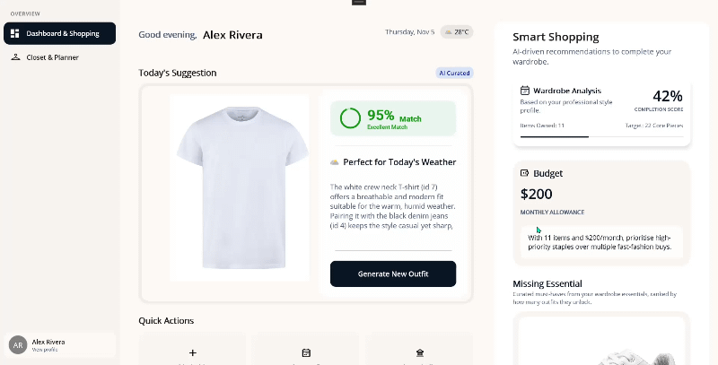

# WardrobeAI



An AI-assisted .NET MAUI wardrobe application that manages clothing, plans outfits, checks weather, compares the closet with a wardrobe essentials catalog, and provides smart shopping recommendations.

## Overview

The app uses EF Core SQLite for wardrobe data and supports Dashboard, Closet, Outfit Planner, Shopping, and Profile areas. Azure OpenAI outfit and shopping services provide live recommendations when configured; local deterministic logic remains available without usable Azure configuration.

## AI Capabilities

- Weather-aware outfit recommendation.
- Outfit score explanations and alternatives.
- Missing-essentials smart-shopping recommendations.
- Budget-aware and pair-aware shopping selection.
- Deterministic fallback recommendations.

## Key Features

- Catalog clothing with category, color, pattern, fabric, brand, season, style, and occasion fields.
- Capture or select clothing images.
- Plan outfits for a date and occasion.
- View weather context and outfit match scores.
- Compare clothing with a bundled essentials catalog.
- Review shopping recommendations and budget information.
- Open retailer links through deep-link services.

## Application Workflow

1. `UserContext` resolves the seeded default user.
2. Repository services load clothing, planned outfits, and shopping data from SQLite.
3. The Closet page adds or updates clothing records.
4. The Outfit Planner builds occasion/date preferences and wardrobe context.
5. `IAIOutfitRecommendationService` requests Azure OpenAI or uses local outfit logic.
6. The Shopping page compares the closet with the essentials catalog.
7. `IAISmartShoppingService` requests AI shopping recommendations or deterministic fallback picks.

## AI Workflow

```text
Wardrobe, Occasion, Date, and Preferences
    ↓
Outfit or Shopping Service
    ↓
Azure OpenAI (when configured)
    ↓
Structured Outfit or Shopping Result
    ↓
ViewModels and UI
```

Without usable endpoint/key/deployment configuration, the services use local fallback logic.

## AI Architecture

- **Views:** Dashboard, Closet, Outfit Planner, Shopping, Profile, and desktop/mobile host pages.
- **ViewModels:** Dashboard, Closet, Planner, Shopping, Profile, host, and split-host view models.
- **AI:** `AI/` contains Azure services, options, prompt builders, contracts, and outfit scoring.
- **Data:** EF Core `WardrobeDbContext` and repository interfaces/classes.
- **Services:** Weather, geolocation, wardrobe analysis, budget, deep-link, navigation, and user context.

The SQLite database is stored at `FileSystem.AppDataDirectory/wardrobe.db`.

## Syncfusion Controls Used

- `SfTabView`
- `SfChipGroup` and `SfChip`
- `SfButton`
- `SfComboBox`
- `SfDatePicker`
- `SfRadialGauge`
- `SfRotator`
- `SfPopup`
- `SfAccordion`
- `SfAvatarView`

## Prerequisites

- .NET 10 SDK.
- .NET MAUI workloads for target platforms (iOS and Mac Catalyst targets are skipped on Linux; the Windows target is built only on Windows).
- Syncfusion MAUI packages referenced by `WardrobeAI.csproj` (Core, Buttons, Rotator, Gauges, Inputs, Popup, Picker, TabView, Expander).
- `Azure.AI.OpenAI`, EF Core SQLite, and CommunityToolkit.Mvvm are restored from NuGet.
- Azure OpenAI configuration only for live AI recommendations.

## Configuration

### AI Configuration

`AzureOpenAiOptions` reads `AZURE_API_BASE` and `AZURE_API_KEY`. Deployment and API version defaults are source values:

| Setting | Source |
| --- | --- |
| Endpoint | `AZURE_API_BASE` |
| API key | `AZURE_API_KEY` |
| Deployment | `gpt-4.1-mini` (source default in `AzureOpenAiOptions`) |
| API version | `ApiVersion` property holds the placeholder `API_VERSION`; it is not read by the services, which use the `Azure.AI.OpenAI` SDK defaults |

The endpoint must be an absolute HTTP/HTTPS URL (for example `https://your-resource.openai.azure.com/`). The app does not bind these values from `appsettings.json`, and live AI stays disabled (the services use their fallback logic) until both the endpoint and key are set. To change the deployment name, edit `AzureOpenAiOptions.Deployment` or configure the options in `MauiProgram.cs`.

Set the environment variables in the environment that launches the app (for example, before starting the IDE) so the process can see them.

### Syncfusion License

The license is read from the `SYNCFUSION_LICENSE_KEY` environment variable in `MauiProgram.cs`. If it is not set, no key is registered.

Weather and reverse-geocoding use the Open-Meteo forecast and reverse-geocoding APIs with platform geolocation; no weather API key is defined by the sample.

## Getting Started

Run from `Use Case Samples/WardrobeAI`:

```sh
dotnet restore WardrobeAI/WardrobeAI.csproj

dotnet build WardrobeAI/WardrobeAI.csproj -t:Run -f net10.0-android
dotnet build WardrobeAI/WardrobeAI.csproj -t:Run -f net10.0-ios
dotnet build WardrobeAI/WardrobeAI.csproj -t:Run -f net10.0-maccatalyst
dotnet build WardrobeAI/WardrobeAI.csproj -t:Run -f net10.0-windows10.0.19041.0
```

## Project Structure

```text
WardrobeAI/
├── WardrobeAI.slnx
└── WardrobeAI/
    ├── AI/
    ├── Constants/
    ├── Contracts/
    ├── Converters/
    ├── Data/
    ├── Helpers/
    ├── Models/
    ├── Platforms/
    ├── Properties/
    ├── Repositories/
    ├── Resources/
    ├── Services/
    ├── ViewModels/
    ├── Views/
    ├── App.xaml
    ├── AppShell.xaml
    ├── MauiProgram.cs
    └── WardrobeAI.csproj
```

## Troubleshooting

- **AI recommendations use fallback data:** Verify that `AZURE_API_BASE` (an absolute URL) and `AZURE_API_KEY` are set and visible to the app process, and that the deployment name exists.
- **Weather is unavailable:** Verify network access and location permission.
- **Database issue:** Confirm the app can write under `FileSystem.AppDataDirectory`.
- **License watermark:** Set `SYNCFUSION_LICENSE_KEY` before launching the app.

## Responsible AI Considerations

- Outfit and shopping recommendations are advisory.
- Prompt context includes wardrobe and planning preferences.
- Do not enter unnecessary personal or confidential information.
- Azure credentials must not be committed to source control.

## Related Documentation

- [Syncfusion .NET MAUI Controls](https://help.syncfusion.com/maui/introduction/overview)
- [Azure OpenAI Documentation](https://learn.microsoft.com/azure/ai-services/openai/)
- [.NET MAUI Documentation](https://learn.microsoft.com/dotnet/maui/)

## Supported Platforms

- Android
- iOS
- macOS (Mac Catalyst)
- Windows

## Limitations

- AI fallback is deterministic or randomized local logic, not live Azure generation.
- Weather/location availability depends on device permissions and network access.
- Store links depend on platform/application support.

## License

Syncfusion controls require a valid Syncfusion license for production use.
